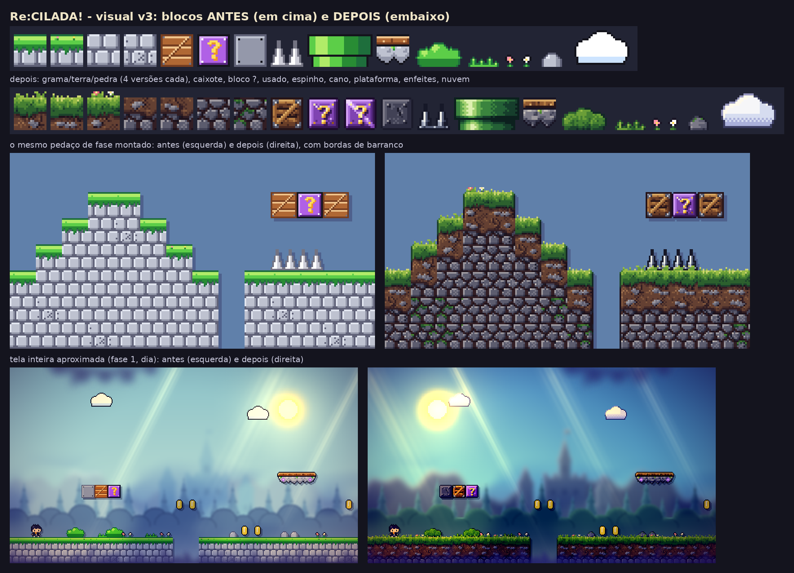
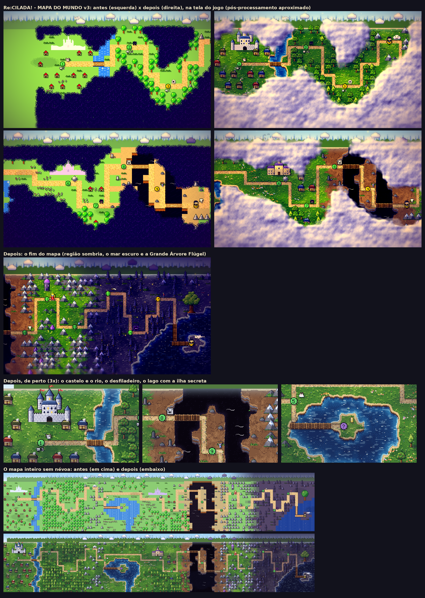

# Re:CILADA!

> *Começando a vida do zero (de novo, e de novo...)*

**Re:CILADA!** é um jogo de plataforma 2D "troll", no estilo de *Cat Mario* e *Level Devil*, com o tema de **Re:Zero**.
Você é o Subaru: tudo parece normal, mas o chão cai, espinhos brotam do nada, a bandeira foge e as nuvens têm dentes.
Cada morte é um **Retorno pela Morte**: você volta, lembra onde errou e tenta de novo, até chegar à Emilia.

- **Jogar no navegador:** (link da página do itch.io)
- **Game jam:** [Projeto Jogo 2D Insper 2026.2](https://itch.io/jam/projeto-jogo-2d-insper-20262)
- **GDD:** [`GDD.md`](GDD.md), organizado pelo DDE (Design, Dinâmica, Experiência). A versão em cartões fica no Milanote: (link do Milanote)
- Fan game feito para a disciplina **Projeto 2D (Insper)**. Não tem fins comerciais.





*As imagens acima são **prévias** montadas fora da Unity pelas ferramentas de desenvolvimento, para comparar as versões ("antes x depois").
O pós-processamento é aproximado. As capturas do jogo rodando ficam na página do itch.io.*

---

## Sumário
1. [Como jogar](#como-jogar)
2. [Segredos](#segredos)
3. [As fases](#as-fases)
4. [Os chefes](#os-chefes)
5. [Atalhos de teste (para avaliação)](#atalhos-de-teste-para-avaliação)
6. [Como abrir e rodar no Unity](#como-abrir-e-rodar-no-unity)
7. [Como gerar o build WebGL (itch.io)](#como-gerar-o-build-webgl-itchio)
8. [Estrutura do código](#estrutura-do-código)
9. [Créditos e referências](#créditos-e-referências)
10. [Licença e aviso](#licença-e-aviso)

---

## Como jogar

### Objetivo
Leve o Subaru do começo de cada fase até a **bandeira de verdade**. São 16 fases ligadas por um **mapa do mundo** (estilo *Super Mario World*).
No caminho há 3 chefes, e na última fase a Emilia espera o Subaru.
Você vai morrer muito, e é assim que o jogo funciona: cada armadilha só pega uma vez, se você prestar atenção.

### Controles
Os controles abaixo são os de `Assets/Scripts/Nucleo/Controles.cs`. Teclado e controle (gamepad) funcionam ao mesmo tempo.

| Ação | Teclado | Controle |
|---|---|---|
| Andar | **A / D** ou **← / →** | analógico esquerdo ou direcional |
| Pular (segure para pular mais alto) | **Espaço**, **W** ou **↑** | botão de baixo (A / ✕) |
| Reiniciar a fase (conta como morte 😈) | **R** | botão de cima (Y / △) |
| Pausar / continuar | **Esc** | Start ou Select |
| Confirmar nos menus | **Enter** ou **Espaço** | Start ou botão de baixo |
| Escolher nos menus | **↑ / ↓** (ou W / S) | direcional |
| Mudar um valor (volume, gráficos) | **← / →** | direcional |
| Pular a animação da morte (depois de 0,5 s) | **Espaço / Enter** | botão de baixo |
| Entrar numa porta da Beatrice | **S** ou **↓** | direcional para baixo |
| No mapa: andar pelo caminho / entrar na fase | **setas** / **Enter** | direcional / botão de baixo |
| No mapa: voltar ao título | **Esc** | Start |

### Menus
- **Título:** Continuar (a partida salva), Novo jogo, Conquistas, Opções, Como Jogar, Créditos e Sair (o Sair não aparece no navegador).
- **Pausa:** Continuar, Reiniciar fase, Opções (volume da música, volume dos efeitos, gráficos **HD-2D** ou **Simples**) e Voltar ao mapa. O progresso fica salvo.
- **Mapa do mundo:** cada ponto é uma fase. Verde = já passou nesta partida, amarelo = liberada. A caveira embaixo do ponto mostra quantas vezes você morreu ali.
  O mapa começa coberto pela névoa da Bruxa, que vai sumindo conforme você avança.

### HUD
- Em cima, à esquerda: o nome da fase ("Fase 3/16: Corre!") e o total de mortes.
- Em cima, à direita: as moedas e o tempo de jogo.
- Uma barrinha de progresso até a bandeira mais distante (de propósito: ela não entrega qual bandeira é a de verdade).
- Nas lutas: a barra de vida do chefe, dividida em 3 etapas.

### Dicas
- **Não confie no Puck.** As placas dele às vezes ajudam e às vezes mentem. ("Chão 100% seguro à frente.")
- **Não confie em nada que pareça normal:** moedas, nuvens, bandeiras, blocos `?` e até o chão podem ser armadilha.
- Olhe a **marca da mão da Bruxa**: ela fica no lugar das suas últimas 5 mortes na fase.
- O **cristal de save** guarda o ponto onde você renasce... mas em 25% das mortes ele "muda de lugar" e você volta para o começo. (Isso não acontece nas fases de chefe.)
- Nos chefes, **todo ataque avisa antes** (linha vermelha, "!", marca no chão, olhos vermelhos) e os **padrões são fixos**: dá para decorar.
  Se morrer, você volta **na mesma etapa** da luta.
- A partir da 3ª morte na mesma fase, a animação da morte fica mais curta. Ela também pode ser pulada.

---

## Segredos

> ⚠️ Spoilers!

- **Fase secreta, o "Santuário do Puck":** na fase 5, *"Eu mudo de ideia"*, pegue **todas as moedas** (as moedas `$` e os blocos `?`) **numa mesma tentativa** e chegue à bandeira.
  Cuidado: uma das moedas é uma **moeda assassina**, e essa não conta. Se você conseguir, o Puck avisa e uma ilha aparece no lago do mapa.
  No **ponto 5** do mapa, aperte **↓ (ou S)** para atravessar a ponte até a ilha.
  (No código: `Fases.FaseDoSegredo = 4` e `GerenciadorDoJogo.FaseConcluida`. Um Novo jogo esconde a secreta de novo.)
- **Conquistas:** são 23 (lista no título, salvas para sempre). Algumas são segredos, como "Olhou para o céu" (ser mordido por uma nuvem),
  "Mudaram meu save!", "Passageiro da Expressa" (ir até o fim na plataforma expressa sem pular) e "Fora do Ritmo".
- **Recorde:** zere o jogo **em ordem, desde a fase 1**, com o menor número de mortes. O recorde aparece no título.
  Se você pular fases pelo mapa, a partida não vale para o recorde.
- **Título no final:** o número de mortes dá um título ao jogador, de "Suspeito de hack" até "Natsuki Subaru honorário".

---

## As fases

| # | Fase | Mecânica principal |
|---|---|---|
| 1 | Bem-vindo :) | Tutorial "mentiroso": chão que cai, bloco invisível, espinho escondido, bloco `?` que solta inimigo, cano com a mão da Bruxa e a **bandeira que foge**. |
| 2 | Confia em mim | Esmagadores, **nuvem assassina**, mola, chão falso e a primeira **bandeira falsa** (que mata). |
| 3 | Corre! | **Serras**: uma persegue você por trás desde o começo e outra vem pela frente. Primeiro cristal de save. |
| 4 | O Final (sem pegadinhas) | Nada é "o final". Estreia dos **Grandes Coelhos**, que pulam atrás de você e se multiplicam. |
| 5 | Eu mudo de ideia | **Moeda assassina** no meio das moedas de verdade. É a fase que libera a secreta. |
| 6 | Oni de Cabelo Azul | **Mangual da Rem** (a bola só mata na corrente girando) e o **CHEFE: Rem**. |
| 7 | Cadê a direita? | **Controles invertidos**, só num trecho e com aviso. Também tem o Mabeast "espinhoso" (não pise nele). |
| 8 | Foge, bloco! | **Blocos tímidos** que fogem quando você pula perto, e a bandeira que te manda **de volta ao começo**. |
| 9 | Ponte para a Capital | **Plataformas mágicas** sobre o abismo (de noite). Umas despencam e a "expressa" dispara. |
| 10 | Voa, Barusu! | **Vento da Ram**: rajadas que empurram para trás, e **redemoinhos** que levantam (um deles é traiçoeiro). |
| 11 | Biblioteca Proibida | **Portas da Beatrice**, um quebra-cabeça de salas. Cada porta sempre leva ao mesmo lugar, então dá para decorar. |
| 12 | Dança das Gêmeas | **Blocos do ritmo** azul (Rem) e rosa (Ram), que se revezam a cada 1,4 s ("tic, tic, TAC"), e esmagadores no compasso. |
| 13 | A Caçadora de Entranhas | Fase **no escuro**. A Elsa joga facas das sombras e é o **CHEFE: Elsa**. |
| 14 | Eu Te Amo (CORRE!) | **Miasma da Bruxa**: uma parede de sombra que persegue você pela fase inteira. Só correr e pular. |
| 15 | O Verdadeiro Final (juro) | Revisão de tudo (serra, coelhos, bandeira que foge, bandeira falsa com degrau, chão que cai). |
| 16 | A Baleia Branca | Aquecimento à noite e o **CHEFE FINAL: Baleia Branca**. A Emilia espera no fim. |
| ★ | Santuário do Puck (secreta) | Só moedas e molas, "sem pegadinha"... ("tá, só uma"). |

As fases são desenhadas em texto em `Assets/Scripts/Nucleo/Fases.cs`. Cada caractere é um bloco, e a legenda completa fica no topo do arquivo.

---

## Os chefes

Os três seguem o mesmo molde, inspirado no chefe final de *Helltaker*: **3 etapas de 2 golpes**, ataques que matam com um toque mas sempre **avisam antes**,
**padrões fixos** (nada é sorteado) e checkpoint por etapa (morreu, volta na mesma etapa sem a introdução longa). A barra de vida fica no topo da tela.

### Rem (fase 6, "Oni de Cabelo Azul")
- Ataques com o mangual:
  - **arremesso:** linha baixa = pule, linha alta = não pule;
  - **giro:** fique fora do anel vermelho ou colado nela;
  - **salto:** a marca no chão segue você;
  - **golpe de cima:** solta pedras rolando.
- Na etapa 3 ela vira **Oni**: fica mais rápida e ataca em combos.
- **Como vencer:** depois do golpe de cima, a bola fica **presa no chão** e a Rem fica puxando a corrente. **Pule na cabeça dela.**

### Elsa (fase 13, "A Caçadora de Entranhas")
- A luta é **no escuro**: só aparecem os olhos dela. Olhos vermelhos = vai atacar.
- Ataques: faca mirada, leque de facas, chuva de facas, corte rente (pule), corte alto (não pule), bumerangue e "atrás de você".
- Na etapa 3 a escuridão fecha.
- **Como vencer:** no fim de cada rodada aparece um **cristal de luz**. Encoste nele: o clarão deixa a Elsa tonta e à vista, e aí você **pula na cabeça dela**.

### Baleia Branca (fase 16, chefe final)
- Uma orca gigante com chifre. Ataques:
  - **investida:** alta = não pule, baixa = pule;
  - barbatana rasgando o chão;
  - chuva de névoa;
  - correntes;
  - onda de choque;
  - raio do chifre.
- Na etapa 2 vêm dois ataques ao mesmo tempo. Na etapa 3 o chão desmorona em dois lugares, ela faz uma finta e a arena escurece.
- **Como vencer:** no fim de cada rodada ela dá um **mergulho** (a marca no chão segue você e trava). Saia de baixo: ela fica **atordoada**, e você **pula na cabeça dela**.
  Depois de vencê-la, a névoa se abre e o caminho até a bandeira e a Emilia fica livre.

---

## Atalhos de teste (para avaliação)

> Estes atalhos existem **para testes e para a avaliação da disciplina**. Eles não fazem parte da experiência normal.

| Tecla | Onde | O que faz |
|---|---|---|
| **F9** | no mapa do mundo | Libera **todas** as fases, os chefes e a secreta, **só na partida atual**. A partida deixa de valer para o recorde, e um Novo jogo volta tudo para a névoa. |
| **F10** (ou a tecla à esquerda do 1) | em qualquer tela | **Painel de gráficos**: liga e desliga cada efeito visual e mostra o FPS e o pior quadro. |

Também dá para começar direto numa fase. Durante o Play, selecione o objeto `GerenciadorDoJogo`, mude **Fase Inicial** no Inspector,
volte ao título e escolha **Novo jogo**.

---

## Como abrir e rodar no Unity

1. Instale o **Unity 6000.6.2f1** (Unity 6) pelo Unity Hub.
   Para gerar o build para o navegador, instale também o módulo **Web Build Support**.
2. Clone o repositório:
   ```
   git clone (link do repositório no GitHub)
   ```
3. No Unity Hub: **Add → Add project from disk** e escolha a pasta do projeto. A primeira abertura importa os pacotes e demora alguns minutos.
4. Abra a cena `Assets/Scenes/SampleScene` e aperte **Play**.
   O jogo se monta sozinho por código: o `GerenciadorDoJogo` se cria ao dar Play, então não é preciso arrastar nada para a cena.
5. No Console deve aparecer `[Re:CILADA] visual v3 (HD-2D escuro) rodando...`.
   Se essa linha não aparecer, há um erro de compilação (mensagem vermelha) e a Unity está rodando a última versão que compilou.

---

## Como gerar o build WebGL (itch.io)

1. **File → Build Profiles → Web → Switch Platform**.
2. Confira se `Assets/Scenes/SampleScene` está na lista de cenas. Ela é a única cena do jogo.
3. Em **Player Settings → Publishing Settings**:
   - **Compression Format = Gzip**;
   - marque **Decompression Fallback** (assim funciona em qualquer servidor, inclusive no itch.io).
4. Em **Player Settings → Resolution and Presentation**, use 1280 x 720.
5. Clique em **Build** e escolha uma pasta vazia.
6. Compacte o **conteúdo** da pasta em .zip (o `index.html` precisa ficar na raiz do .zip).
7. No itch.io: **Upload new project → Kind of project: HTML**.
   - Envie o .zip e marque *"This file will be played in the browser"*.
   - Tamanho da tela: 1280 x 720, com o botão de tela cheia.
   - Inscreva o projeto na jam: https://itch.io/jam/projeto-jogo-2d-insper-20262
8. Se o navegador ficar lento, use **Gráficos: Simples** no menu de pausa, que desliga os efeitos pesados.

O progresso (PlayerPrefs) fica salvo no navegador de cada jogador.

---

## Estrutura do código

**Tudo é procedural.** O jogo não importa imagens nem efeitos sonoros:
- **arte:** os sprites são *pixel art escrita em texto* (cada letra é uma cor da paleta) ou desenhados por fórmula, com rampas de cor, dithering e luz de cima-esquerda;
- **fases e mapa:** são desenhados em texto, e cada caractere é um bloco;
- **música:** é **composta e sintetizada por código** (composição original, com piano, cordas, violino e bateria);
- **efeitos sonoros:** são ondas 8-bit geradas por código.

Os únicos arquivos externos são os **dois áudios do Retorno pela Morte** (veja os [créditos](#créditos-e-referências)).

```
Assets/
  Scenes/SampleScene.unity      a única cena (o jogo se monta por código)
  Resources/Sons/               os 2 áudios do anime (Retorno pela Morte e OST da morte)
  Resources/Shaders/            2 shaders próprios (luz aditiva e sombra multiplicada)
  Scripts/
    Nucleo/      o "motor" do jogo: estados, fases, mapa, interface, arte, som e efeitos
    Jogador/     o Subaru (física e game feel)
    Armadilhas/  uma classe por armadilha/mecânica
    Objetos/     inimigos, chefes, bandeiras, placas, portas, moedas, save
Ferramentas/     scripts Python de apoio (checador de fases) e prévias em imagem
```

### Nucleo/
- `GerenciadorDoJogo.cs`: a máquina de estados (Título, Conquistas, Mapa, Jogando, Pausado, Morreu, FaseConcluida, Vitória, Créditos), as mortes, as moedas, o tempo e os checkpoints.
- `Fases.cs`: as 16 fases e a secreta desenhadas em texto, a legenda das mecânicas e as mensagens de morte.
- `ConstrutorDeFase.cs`: lê o texto da fase e cria os objetos (o chão vira um único `CompositeCollider2D`).
- `MapaDoMundo.cs`: o mapa do mundo em texto, com caminhos, névoa e o Subaru andando.
  A arte do mapa fica em `ArteDoMapa.cs` e `ArteDoMapaEnfeites.cs`, e a névoa e a animação em `NevoaDoMapa.cs` e `VidaDoMapa.cs`.
- `Interface.cs`: tudo o que é desenhado por cima do jogo (HUD, menus, pausa, morte, falas, barra do chefe, transições). Usa IMGUI e a fonte pixel própria.
- `Controles.cs`: a leitura de teclado e controle (Input System).
- `Progresso.cs`: o save em PlayerPrefs (continuar, mortes por fase, secreta, recorde), com validação de versão.
- `Conquistas.cs`, `Opcoes.cs` e `Textos.cs`: as 23 conquistas, o volume e os gráficos, e as falas do mapa e os créditos.
- `FabricaDeSprites.cs` e `ArteDosBlocos.cs`: a arte procedural dos personagens, dos blocos e dos enfeites, e a fonte pixel com acentos.
- `FabricaDeEpico.cs` e `FabricaDeMusica.cs`: a música original sintetizada (versões de fase, mapa e chefe, e um lofi 8-bit alternativo).
- `FabricaDeSons.cs`, `Musica.cs` e `SonsDaMorte.cs`: os efeitos 8-bit, a música de fundo e o áudio do Retorno pela Morte sincronizado com o renascimento.
- `EfeitosDeTela.cs`: o pós-processamento do URP (bloom, vinheta, cor de cinema e o efeito da morte).
- `TelaPixelada.cs`: pixel nítido em escala inteira e tilt-shift.
- `FeixesDeLuz.cs`, `SombrasDeNuvens.cs`, `Vento.cs` e `LuzDoDia.cs`: raios de sol, sombras de nuvens, plantas ao vento e a hora do dia.
- `Paralaxe.cs`, `PrimeiroPlano.cs`, `Ambiente.cs`, `Luzes.cs`, `ArteHD2D.cs` e `MateriaisHD2D.cs`: o fundo em camadas, o primeiro plano desfocado, as partículas, as luzes 2D e os materiais.
- `CameraSeguir.cs`, `Efeitos.cs`, `Particula.cs`, `MarcaDaMorte.cs` e `Sombra*.cs`: a câmera com tremida, a poeira, a marca da Bruxa e as sombras.
- `AjustesVisuais.cs` e `PainelDeGraficos.cs`: os valores de cada efeito e o painel de testes (F10).

### Jogador/
- `Jogador.cs`: física com Rigidbody2D, pulo variável, *coyote time*, *buffer* de pulo, estica-e-achata e a inversão de controles.

### Armadilhas/
- `Perigo.cs`: a base ("encostou, morreu").
- Armadilhas clássicas: `ChaoQueCai`, `EspinhoEscondido`, `EspinhoQueCai`, `Espinho`, `BlocoInvisivel`, `BlocoSurpresa`, `BlocoQueFoge`, `Mola`, `Serra`, `Esmagador`, `Cano`, `NuvemAssassina` e `MoedaAssassina`.
- Mecânicas temáticas: `MangualDaRem`, `PlataformaMovel`, `VentoDaRam`, `BlocoDoRitmo`, `EsmagadorDoRitmo`, `FacasDaElsa` e `MiasmaDaBruxa`.

### Objetos/
- `Chefe.cs`: a base dos chefes.
- Os chefes: `ChefeRem.cs`, `ElsaCacadora.cs` e `BaleiaBranca.cs`, com a arte em `ArteDaRem.cs` e `ArteDaBaleia.cs`.
- `Inimigo` (Mabeast) e `Coelho` (Grande Coelho).
- `Bandeira`, `BandeiraFalsa`, `BandeiraFujona` e `BandeiraVolta`.
- `Placa` (o Puck e a Beatrice), `Porta`, `PontoDeSave`, `Moeda` e `Emilia`.

### Ferramentas/
- `extrair_fases.py`: tira os mapas de `Fases.cs` e grava em JSON.
- `checar_fase.py`: simula a física do `Jogador.cs` e confere se o terreno de cada fase dá para passar.
- `previews/`: imagens de prévia do visual, do mapa e dos chefes.

### Criar uma fase nova
1. Copie um bloco `new Fase { ... }` em `Fases.cs` e desenhe a fase com os caracteres da legenda.
2. Ponha o número dela no desenho do `MapaDoMundo`, ligado à fase anterior por um caminho de `+`.
3. Ponha a fala do mapa em `Textos.DepoisDaFase`.
4. Teste o terreno:
   ```
   python3 Ferramentas/extrair_fases.py Assets/Scripts/Nucleo/Fases.cs /tmp/fases
   python3 Ferramentas/checar_fase.py /tmp/fases/fase_00.json --de s
   ```

---

## Créditos e referências

### Equipe
> Edite com os nomes e as funções de cada integrante.

| Integrante | Função |
|---|---|
| (Nome do integrante 1) | (função: ex. programação, chefes) |
| (Nome do integrante 2) | (função: ex. level design, fases) |
| (Nome do integrante 3) | (função: ex. arte, efeitos visuais) |
| (Nome do integrante 4) | (função: ex. som, GDD, testes) |

### Obra original e personagens
- **Re:Zero − Starting Life in Another World** (*Re:ゼロから始める異世界生活*):
  - novel de **Tappei Nagatsuki**, ilustrações de **Shin'ichirō Otsuka**, publicada pela **Kadokawa** (MF Bunko J);
  - anime do estúdio **White Fox**.
- O mundo (Lugunica, mansão Roswaal, Biblioteca Proibida) e os personagens (Subaru, Emilia, Puck, Rem, Ram, Beatrice, Elsa, a Bruxa da Inveja e a Baleia Branca) pertencem aos seus autores.
- Este é um **fan game** acadêmico, **sem fins comerciais**. Todos os desenhos dos personagens foram feitos para este jogo, em pixel art por código (nenhuma imagem do anime foi usada).

### Áudio de terceiros
Estes são os **únicos arquivos de mídia externos** do projeto. Eles foram usados para fins **educacionais**, **sem fins comerciais**, com todos os direitos reservados aos detentores.

| Arquivo | Origem |
|---|---|
| `Assets/Resources/Sons/retorno_pela_morte.mp3` | Som do "Retorno pela Morte" do anime **Re:Zero** (trilha sonora de **Kenichiro Suehiro**; White Fox / Kadokawa) |
| `Assets/Resources/Sons/ost_morte.mp3` | Trecho da trilha sonora do anime **Re:Zero**, composta por **Kenichiro Suehiro** |

Todo o resto do áudio (música de fase, de mapa e de chefe, e os efeitos sonoros) é **composição original gerada por código** (`FabricaDeEpico.cs`, `FabricaDeMusica.cs` e `FabricaDeSons.cs`).

### Inspirações de design
- **Cat Mario / Syobon Action** e **Level Devil**: as armadilhas que subvertem o que o jogador espera.
- **Helltaker**: as lutas de chefe (etapas com checkpoint, ataques telegrafados e padrões fixos).
- **Super Mario World**: o mapa do mundo.
- **Octopath Traveler** (HD-2D) e **Stardew Valley** (e seus mods visuais): o visual (pixel art com luz, desfoque de profundidade, raios de sol e sombras de nuvem).
  Nenhum asset desses jogos foi usado: só as ideias.

### Pacotes e tecnologia
- **Unity 6 (6000.6.2f1)**, com o template 2D URP da Unity.
- Pacotes da Unity usados pelo código:
  - **Universal Render Pipeline** `com.unity.render-pipelines.universal` 17.6.0 (renderizador 2D, luzes 2D e pós-processamento);
  - **Input System** `com.unity.inputsystem` 1.19.0.
- Outros pacotes que vieram com o template (em `Packages/manifest.json`), mas que o jogo não usa diretamente:
  - 2D Sprite, Tilemap, Tilemap Extras, Animation, SpriteShape, Aseprite Importer, PSD Importer e 2D Tooling;
  - uGUI, Timeline, Visual Scripting, Test Framework, Collab Proxy e a integração com IDEs (Rider e Visual Studio);
  - Unity AI Assistant e AI Inference, Pipeline e IET Framework.
- A pasta `Assets/Welcome` e o `InputSystem_Actions.inputactions` vieram do template 2D da Unity.
- **Fontes:** nenhuma fonte externa (.ttf/.otf). O texto usa uma fonte pixel desenhada em código (`FabricaDeSprites.TextoEmPixel`).
- **Imagens:** nenhuma imagem externa no jogo. Os sprites são gerados em tempo de execução.
- **Shaders:** `LuzAditiva` e `SombraMultiplicada`, escritos para este projeto.

### Ferramentas usadas
- **Unity 6** e **C#**: o jogo.
- **Python 3**: as ferramentas em `Ferramentas/` (extrair fases, checar se o terreno dá para passar, gerar prévias).
- **Git e GitHub**: versionamento.
- **Milanote**: o GDD.
- **Assistente de IA (Claude, da Anthropic)**: usado como ferramenta de apoio ao desenvolvimento (programação, revisão e documentação), sob direção e revisão da equipe.

---

## Licença e aviso

Projeto **acadêmico** feito para a disciplina Projeto 2D do Insper (2026). **Não comercial.**
Re:Zero e seus personagens, nomes e músicas pertencem aos seus respectivos donos (Tappei Nagatsuki, Shin'ichirō Otsuka, Kadokawa, White Fox e Kenichiro Suehiro).
Este projeto não é afiliado a eles nem tem o endosso deles. Se algum detentor de direitos pedir, o conteúdo será removido.
O código e a arte procedural feitos pela equipe podem ser estudados para fins educacionais.
