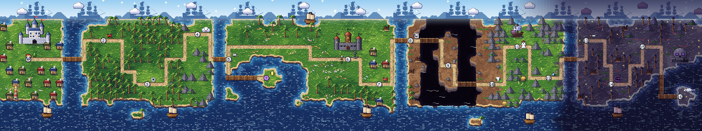
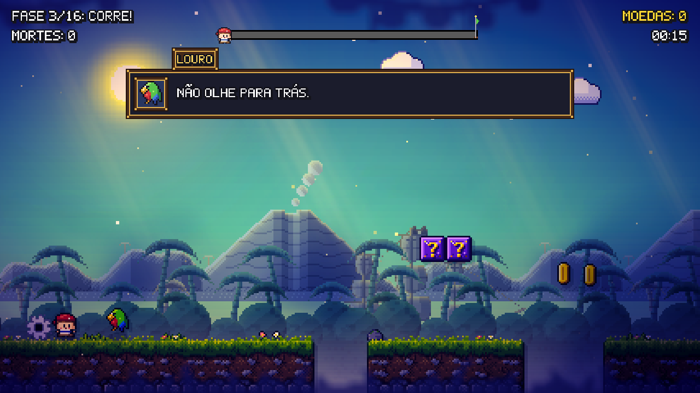
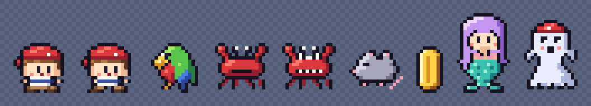
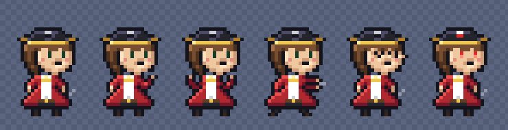
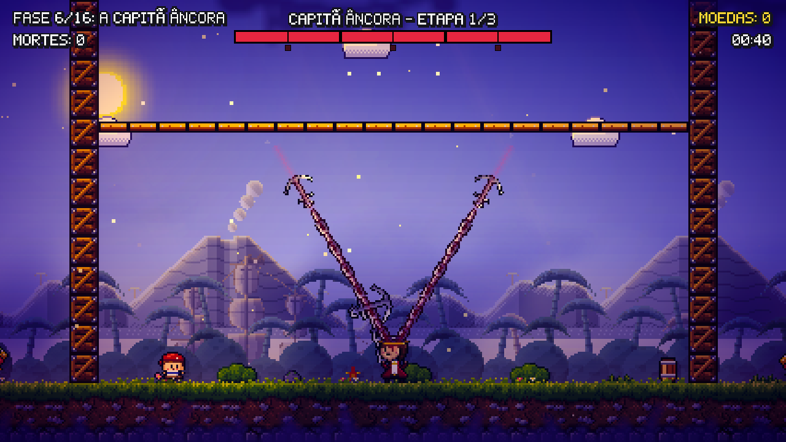

# CILADA À VISTA!

> *Toda morte é só o começo da viagem...*

**CILADA À VISTA!** é um jogo de plataforma 2D "troll", no estilo de *Cat Mario* e *Level Devil*, com o tema de **piratas**.
Você é o Grumete, o marujo mais novo do navio: tudo parece normal, mas o chão cai, espinhos brotam do nada, a bandeira foge e as nuvens têm dentes.
Cada morte é uma **Volta da Maré**: a onda te traz de volta, você lembra onde errou e tenta de novo, de ilha em ilha, até reencontrar a Marina.

- **Jogar no navegador:** (link da página do itch.io)
- **Game jam:** [Projeto Jogo 2D Insper 2026.2](https://itch.io/jam/projeto-jogo-2d-insper-20262)
- **GDD:** [`GDD.md`](GDD.md), organizado pelo DDE (Design, Dinâmica, Experiência). A versão em cartões fica no Milanote: (link do Milanote)
- Jogo **original** feito para a disciplina **Projeto 2D (Insper)**. Não tem fins comerciais.







*O mapa e a folha dos personagens são **prévias** montadas pelas ferramentas de desenvolvimento (sem o pós-processamento);
a fase é uma captura do jogo rodando no editor da Unity.*

---

## Sumário
1. [Como jogar](#como-jogar)
2. [Segredos](#segredos)
3. [As fases](#as-fases)
4. [Os chefes](#os-chefes)
5. [Atalhos de teste (para avaliação)](#atalhos-de-teste-para-avaliação)
6. [Como abrir e rodar no Unity](#como-abrir-e-rodar-no-unity)
7. [Como gerar o build WebGL (itch.io)](#como-gerar-o-build-webgl-itchio)
8. [Estrutura do código](#estrutura-do-código)
9. [Créditos e referências](#créditos-e-referências)
10. [Licença e aviso](#licença-e-aviso)

---

## Como jogar

### Objetivo
Leve o Grumete do começo de cada fase até a **bandeira de verdade**. São 16 fases ligadas por um **mapa do mundo** (estilo *Super Mario World*): um arquipélago, atravessado de ilha em ilha pelas pontes de madeira.
No caminho há 3 chefes, e na última fase a Marina, a sereia, espera o Grumete.
Você vai morrer muito, e é assim que o jogo funciona: cada armadilha só pega uma vez, se você prestar atenção.

### Controles
Os controles abaixo são os de `Assets/Scripts/Nucleo/Controles.cs`. Teclado e controle (gamepad) funcionam ao mesmo tempo.

| Ação | Teclado | Controle |
|---|---|---|
| Andar | **A / D** ou **← / →** | analógico esquerdo ou direcional |
| Pular (segure para pular mais alto) | **Espaço**, **W** ou **↑** | botão de baixo (A / ✕) |
| Reiniciar a fase (conta como morte 😈) | **R** | botão de cima (Y / △) |
| Pausar / continuar | **Esc** | Start ou Select |
| Confirmar nos menus | **Enter** ou **Espaço** | Start ou botão de baixo |
| Escolher nos menus | **↑ / ↓** (ou W / S) | direcional |
| Mudar um valor (volume, gráficos) | **← / →** | direcional |
| Pular a animação da morte (depois de 0,5 s) | **Espaço / Enter** | botão de baixo |
| Entrar numa porta das Cabines Assombradas | **S** ou **↓** | direcional para baixo |
| No mapa: andar pelo caminho / entrar na fase | **setas** / **Enter** | direcional / botão de baixo |
| No mapa: voltar ao título | **Esc** | Start |
| Voltar um nível nos menus | **Esc** ou **Backspace** | botão da direita (B / ◯) |
| Na pausa: ir direto para o mapa | **Q** | — |
| Menus com mouse | passar o mouse escolhe, **clique** confirma, **botão direito** volta | — |

### Menus
- **Título:** Continuar (só se houver partida salva), Novo jogo, Opções, Como jogar, Conquistas, Créditos e Sair (o Sair não aparece no navegador).
- **Pausa:** Continuar, Reiniciar fase (do começo, sem contar morte), Opções, Como jogar, Voltar ao mapa e Voltar ao título. O progresso fica salvo.
- **Opções** (a mesma tela no título e na pausa): volume da música, volume dos efeitos, gráficos **HD-2D** ou **Simples**, tela cheia e cronômetro no HUD.
- **Mapa do mundo:** cada ponto é uma fase. Verde = já passou nesta partida, amarelo = liberada. A caveira embaixo do ponto mostra quantas vezes você morreu ali,
  e as 3 medalhas do lado (relógio, coração e moeda) mostram as que você já ganhou. Embaixo da tela aparece o recorde da fase escolhida.
  O mapa começa coberto pela névoa do alto-mar, que vai sumindo conforme você avança.

### HUD
- Em cima, à esquerda: o nome da fase ("Fase 3/16: Corre!") e o total de mortes.
- Em cima, à direita: as moedas e o tempo de jogo.
- Uma barrinha de progresso até a bandeira mais distante (de propósito: ela não entrega qual bandeira é a de verdade).
- Nas lutas: a barra de vida do chefe, dividida em 3 etapas.

### Dicas
- **Não confie no Louro.** As dicas do papagaio às vezes ajudam e às vezes mentem. ("Chão 100% seguro à frente.")
- **Não confie em nada que pareça normal:** moedas, nuvens, bandeiras, blocos `?` e até o chão podem ser armadilha.
- Olhe o **X vermelho** ("X marca o lugar!"): ele fica onde aconteceram as suas últimas 5 mortes na fase.
- O **cristal de save** guarda o ponto onde você renasce... mas em 25% das mortes ele "muda de lugar" e você volta para o começo. (Isso não acontece nas fases de chefe.)
- Nos chefes, **todo ataque avisa antes** (linha vermelha, "!", marca no chão, olhos vermelhos) e os **padrões são fixos**: dá para decorar.
  Se morrer, você volta **na mesma etapa** da luta.
- A partir da 3ª morte na mesma fase, a animação da morte fica mais curta. Ela também pode ser pulada.

---

## Segredos

> ⚠️ Spoilers!

- **Fase secreta, a "Ilha do Louro":** na fase 5, *"Eu mudo de ideia"*, pegue **todas as moedas** (as moedas `$` e os blocos `?`) **numa mesma tentativa** e chegue à bandeira.
  Cuidado: uma das moedas é uma **moeda assassina**, e essa não conta. Se você conseguir, o Louro avisa e uma ilhota aparece na lagoa do mapa.
  No **ponto 5** do mapa, aperte **↓ (ou S)** para atravessar a ponte até a ilhota.
  (No código: `Fases.FaseDoSegredo = 4` e `GerenciadorDoJogo.FaseConcluida`. Um Novo jogo esconde a secreta de novo.)
- **Conquistas:** são 24 (lista no título, salvas para sempre). Algumas são segredos, como "Olhou para o céu" (ser mordido por uma nuvem),
  "Mudaram meu save!", "Passageiro da Expressa" (ir até o fim na plataforma expressa sem pular), "Buuu!" e "Fora do Ritmo".
- **Recorde:** zere o jogo **em ordem, desde a fase 1**, com o menor número de mortes. O recorde aparece no título.
- **Recordes por fase e medalhas:** cada fase guarda o seu melhor tempo, o menor número de mortes e o maior número de moedas (valem para sempre).
  Cada um dá uma medalha: **relógio** (passar dentro do tempo da meta; o tempo conta desde a entrada pelo mapa, com as mortes),
  **coração** (passar sem morrer) e **moeda** (pegar todas as moedas numa tentativa só). Ganhar as 3 numa fase dá a conquista "Perfeccionista".
  Se você pular fases pelo mapa, a partida não vale para o recorde.
- **Título no final:** o número de mortes dá um título ao jogador, de "Suspeito de hack" até "Grumete imortal".

---

## As fases

| # | Fase | Mecânica principal |
|---|---|---|
| 1 | Bem-vindo :) | Tutorial "mentiroso": chão que cai, bloco invisível, espinho escondido, bloco `?` que solta inimigo, cano com o tentáculo do Kraken e a **bandeira que foge**. |
| 2 | Confia em mim | Esmagadores, **nuvem assassina**, mola, chão falso e a primeira **bandeira falsa** (que mata). |
| 3 | Corre! | **Serras**: uma persegue você por trás desde o começo e outra vem pela frente. Primeiro cristal de save. |
| 4 | O Final (sem pegadinhas) | Nada é "o final". Estreia dos **Ratos do Porão**, que pulam atrás de você e se multiplicam. |
| 5 | Eu mudo de ideia | **Moeda assassina** no meio das moedas de verdade. É a fase que libera a secreta. |
| 6 | A Capitã Âncora | **Âncora giratória** (só a âncora mata, a corrente não) e o **CHEFE: Capitã Âncora**. |
| 7 | Cadê a direita? | **Controles invertidos** ("bombordo é estibordo"), só num trecho e com aviso. Também tem o caranguejo "espinhoso" (não pise nele). |
| 8 | Foge, bloco! | **Blocos tímidos** que fogem quando você pula perto, e a bandeira que te manda **de volta ao começo**. |
| 9 | Ponte para o Porto | **Plataformas mágicas** sobre o abismo (de noite). Umas despencam e a "expressa" dispara. |
| 10 | Vento em Popa! | **Vento do mar**: rajadas que empurram para trás, e **redemoinhos** que levantam (um deles é traiçoeiro). |
| 11 | Cabines Assombradas | **Portas do navio fantasma**, um quebra-cabeça de salas com a Dóris, a fantasminha. Cada porta sempre leva ao mesmo lugar, então dá para decorar. |
| 12 | Dança das Marés | **Blocos do ritmo** azul (da maré) e rosa (do coral), que se revezam a cada 1,4 s ("tic, tic, TAC"), e esmagadores no compasso. |
| 13 | A Cozinheira do Porão | Fase **no escuro**. A Cozinheira joga cutelos das sombras e é o **CHEFE: Cozinheira**. |
| 14 | A Maré Negra (CORRE!) | **Maré Negra do Kraken**: uma parede de tinta com tentáculos que persegue você pela fase inteira. Só correr e pular. |
| 15 | O Verdadeiro Final (juro) | Revisão de tudo (serra, ratos, bandeira que foge, bandeira falsa com degrau, chão que cai). |
| 16 | A Baleia Branca | Aquecimento à noite e o **CHEFE FINAL: Baleia Branca**. A Marina espera no fim. |
| ★ | Ilha do Louro (secreta) | Só moedas e molas, "sem pegadinha"... ("tá, só uma"). |

As fases são desenhadas em texto em `Assets/Scripts/Nucleo/Fases.cs`. Cada caractere é um bloco, e a legenda completa fica no topo do arquivo.

---

## Os chefes

Os três seguem o mesmo molde, inspirado no chefe final de *Helltaker*: **3 etapas de 2 golpes**, ataques que matam com um toque mas sempre **avisam antes**,
**padrões fixos** (nada é sorteado) e checkpoint por etapa (morreu, volta na mesma etapa sem a introdução longa). A barra de vida fica no topo da tela.

O único jeito de dar dano é **pular na cabeça** do chefe **no momento certo**: quando ele fica vulnerável (descrito em "Como vencer").
Cada chefe tem **a sua própria música** de luta, e morrer não recomeça a música.



### Capitã Âncora (fase 6)
- Ataques com a âncora presa na corrente:
  - **arremesso:** linha baixa = pule, linha alta = não pule;
  - **tempestade de âncoras:** ela salta para o meio da arena e dispara várias âncoras **rápidas para todos os lados**. Elas cravam na parede,
    no chão ou no teto e **voltam** pelo mesmo caminho. As linhas vermelhas mostram o caminho de cada uma antes:
    linha baixa do seu lado = pule (na ida e na volta); linha que bate no chão = fuja da ponta dela. Na etapa 3 vêm duas rajadas seguidas;
  - **giro:** fique fora do anel vermelho ou colado nela;
  - **salto:** a marca no chão segue você;
  - **golpe de cima:** solta pedras rolando.
- Ela é rápida e emenda um ataque no outro, e na etapa 3 fica **furiosa**: mais rápida ainda, com combos.
- **Como vencer:** depois do golpe de cima, a âncora fica **presa no chão** e a Capitã fica parada puxando a corrente. É a hora: **pule na cabeça dela**.
  Essa janela é mais longa que a dos outros chefes (3 s na etapa 1, 2,7 s na 2 e 2,4 s na 3).



### Cozinheira (fase 13)
- A luta é **no escuro**, no porão do navio fantasma: só aparecem os olhos dela. Olhos vermelhos = vai atacar.
- Ataques com o cutelo: faca mirada, leque de facas, chuva de facas, corte rente (pule), corte alto (não pule), bumerangue e "atrás de você".
- Na etapa 3 a escuridão fecha.
- **Como vencer:** no fim de cada rodada aparece um **lampião**. Encoste nele: o clarão deixa a Cozinheira **tonta** e à vista. **Pule na cabeça dela.**

### Baleia Branca (fase 16, chefe final)
- Uma orca gigante com chifre. Ataques:
  - **investida:** alta = não pule, baixa = pule;
  - barbatana rasgando o chão;
  - chuva de névoa;
  - correntes;
  - onda de choque;
  - raio do chifre.
- Na etapa 2 vêm dois ataques ao mesmo tempo. Na etapa 3 o chão desmorona em dois lugares, ela faz uma finta e a arena escurece.
- **Como vencer:** no fim de cada rodada ela dá um **mergulho** (a marca no chão segue você e trava). Saia de baixo: ela fica **atordoada**, e você **pula na cabeça dela**.
  Depois de vencê-la, a névoa se abre e o caminho até a bandeira e a Marina fica livre.

---

## Atalhos de teste (para avaliação)

> Estes atalhos existem **para testes e para a avaliação da disciplina**. Eles não fazem parte da experiência normal.

| Tecla | Onde | O que faz |
|---|---|---|
| **F9** | no mapa do mundo | Libera **todas** as fases, os chefes e a secreta, **só na partida atual**. A partida deixa de valer para o recorde, e um Novo jogo volta tudo para a névoa. |
| **F10** (ou a tecla à esquerda do 1) | em qualquer tela | **Painel de gráficos**: liga e desliga cada efeito visual e mostra o FPS e o pior quadro. |

Também dá para começar direto numa fase. Durante o Play, selecione o objeto `GerenciadorDoJogo`, mude **Fase Inicial** no Inspector,
volte ao título e escolha **Novo jogo**.

---

## Como abrir e rodar no Unity

1. Instale o **Unity 6000.6.4f1** (Unity 6) pelo Unity Hub.
   Para gerar o build para o navegador, instale também o módulo **Web Build Support**.
2. Clone o repositório:
   ```
   git clone (link do repositório no GitHub)
   ```
3. No Unity Hub: **Add → Add project from disk** e escolha a pasta do projeto. A primeira abertura importa os pacotes e demora alguns minutos.
4. Abra a cena `Assets/Scenes/SampleScene` e aperte **Play**.
   O jogo se monta sozinho por código: o `GerenciadorDoJogo` se cria ao dar Play, então não é preciso arrastar nada para a cena.
5. No Console deve aparecer `[Cilada à Vista] visual v3 (HD-2D escuro) rodando...`.
   Se essa linha não aparecer, há um erro de compilação (mensagem vermelha) e a Unity está rodando a última versão que compilou.

---

## Como gerar o build WebGL (itch.io)

1. **File → Build Profiles → Web → Switch Platform**.
2. Confira se `Assets/Scenes/SampleScene` está na lista de cenas. Ela é a única cena do jogo.
3. Em **Player Settings → Publishing Settings**:
   - **Compression Format = Gzip**;
   - marque **Decompression Fallback** (assim funciona em qualquer servidor, inclusive no itch.io).
4. Em **Player Settings → Resolution and Presentation**, use 1280 x 720.
5. Clique em **Build** e escolha uma pasta vazia.
6. Compacte o **conteúdo** da pasta em .zip (o `index.html` precisa ficar na raiz do .zip).
7. No itch.io: **Upload new project → Kind of project: HTML**.
   - Envie o .zip e marque *"This file will be played in the browser"*.
   - Tamanho da tela: 1280 x 720, com o botão de tela cheia.
   - Inscreva o projeto na jam: https://itch.io/jam/projeto-jogo-2d-insper-20262
8. Se o navegador ficar lento, use **Gráficos: Simples** no menu de pausa, que desliga os efeitos pesados.

O progresso (PlayerPrefs) fica salvo no navegador de cada jogador.

---

## Estrutura do código

**Tudo é procedural.** O jogo não importa nenhum arquivo de imagem, som ou música:
- **arte:** os sprites são *pixel art escrita em texto* (cada letra é uma cor da paleta) ou desenhados por fórmula, com rampas de cor, dithering e luz de cima-esquerda;
- **fases e mapa:** são desenhados em texto, e cada caractere é um bloco;
- **música:** é **composta e sintetizada por código** (composição original). O sintetizador também foi escrito para o jogo: acordeão, apito, violão, violino,
  as ondas do mar, tambor de mão, pisadas no convés, palmas e o sino do navio, além das ondas "8-bit" de videogame;
- **efeitos sonoros:** são ondas 8-bit geradas por código, e o som da Volta da Maré (a onda e o sino) também.

```
Assets/
  Scenes/SampleScene.unity      a única cena (o jogo se monta por código)
  Resources/Shaders/            2 shaders próprios (luz aditiva e sombra multiplicada)
  Scripts/
    Nucleo/      o "motor" do jogo: estados, fases, mapa, interface, arte, som e efeitos
    Jogador/     o Grumete (física e game feel)
    Armadilhas/  uma classe por armadilha/mecânica
    Objetos/     inimigos, chefes, bandeiras, placas, portas, moedas, save
Ferramentas/     scripts de apoio (checador de fases, gerador das músicas em WAV) e prévias em imagem
```

### Nucleo/
- `GerenciadorDoJogo.cs`: a máquina de estados (Título, Conquistas, Mapa, Jogando, Pausado, Morreu, FaseConcluida, Vitória, Créditos), as mortes, as moedas, o tempo e os checkpoints.
- `Fases.cs`: as 16 fases e a secreta desenhadas em texto, a legenda das mecânicas e as mensagens de morte.
- `ConstrutorDeFase.cs`: lê o texto da fase e cria os objetos (o chão vira um único `CompositeCollider2D`).
- `MapaDoMundo.cs`: o mapa do mundo em texto (o arquipélago), com caminhos, pontes, névoa e o Grumete andando.
  A arte do mapa fica em `ArteDoMapa.cs` (o chão, o mar e as praias) e `ArteDoMapaEnfeites.cs` (palmeiras, forte, navios, farol, Rocha da Caveira...),
  e a névoa e a animação em `NevoaDoMapa.cs` e `VidaDoMapa.cs`.
- `Interface.cs`: tudo o que é desenhado por cima do jogo (HUD, menus, pausa, morte, falas, barra do chefe, transições). Usa IMGUI e a fonte pixel própria.
- `Controles.cs`: a leitura de teclado e controle (Input System).
- `Progresso.cs`: o save em PlayerPrefs (continuar, mortes por fase, secreta, recorde e os recordes de cada fase), com validação de versão.
- `Medalhas.cs`: as 3 medalhas de cada fase (tempo, sem morrer, todas as moedas), o tempo-alvo e o desenho delas.
- `Conquistas.cs`, `Opcoes.cs` e `Textos.cs`: as 24 conquistas, o volume e os gráficos, e as falas do mapa e os créditos.
- `ArteDosPersonagens.cs`: o Grumete, o Louro, os caranguejos, o rato, a Marina, a Dóris e a moeda, com uma paleta de três tons por material.
- `FabricaDeSprites.cs` e `ArteDosBlocos.cs`: a arte procedural dos blocos, dos enfeites e dos fundos, o sombreamento automático dos desenhos grandes
  e a fonte pixel com acentos.
- `Musicas.cs`: **todas** as músicas (a jiga das fases, a balada do mapa e a música de luta de cada chefe), escritas em texto (como as fases)
  e tocadas por um sintetizador próprio. É C# puro, sem Unity, então dá para gerar os WAVs fora do jogo.
- `FabricaDeMusica.cs` e `Musica.cs`: transformam as músicas em AudioClips (cada fase num tom um pouco diferente) e tocam a música de fundo.
- `FabricaDeSons.cs`, `SomDaMare.cs` e `SonsDaMorte.cs`: os efeitos 8-bit e o som da Volta da Maré (a onda, o sino do navio e o lamento do acordeão), sincronizado com o renascimento.
- `EfeitosDeTela.cs`: o pós-processamento do URP (bloom, vinheta, cor de cinema e o efeito da morte).
- `TelaPixelada.cs`: pixel nítido em escala inteira (e o tilt-shift opcional, desligado de fábrica: liga no F10).
- `FeixesDeLuz.cs`, `SombrasDeNuvens.cs`, `Vento.cs` e `LuzDoDia.cs`: raios de sol, sombras de nuvens, plantas ao vento e a hora do dia.
- `Paralaxe.cs`, `PrimeiroPlano.cs`, `Ambiente.cs`, `Luzes.cs`, `ArteHD2D.cs` e `MateriaisHD2D.cs`: o fundo em camadas (ilhas, galeão, palmeiras, nítidas e com a luz pintada), o primeiro plano, as partículas, as luzes 2D e os materiais.
- `CameraSeguir.cs`, `Efeitos.cs`, `Particula.cs`, `MarcaDaMorte.cs` e `Sombra*.cs`: a câmera com tremida, a poeira, o X vermelho das mortes e as sombras.
- `AjustesVisuais.cs` e `PainelDeGraficos.cs`: os valores de cada efeito e o painel de testes (F10).

### Jogador/
- `Jogador.cs`: física com Rigidbody2D, pulo variável, *coyote time*, *buffer* de pulo, estica-e-achata e a inversão de controles.

### Armadilhas/
- `Perigo.cs`: a base ("encostou, morreu").
- Armadilhas clássicas: `ChaoQueCai`, `EspinhoEscondido`, `EspinhoQueCai`, `Espinho`, `BlocoInvisivel`, `BlocoSurpresa`, `BlocoQueFoge`, `Mola`, `Serra`, `Esmagador`, `Cano`, `NuvemAssassina` e `MoedaAssassina`.
- Mecânicas temáticas: `Ancora`, `PlataformaMovel`, `VentoDoMar`, `BlocoDoRitmo`, `EsmagadorDoRitmo`, `FacasDaCozinheira` e `MareNegra`.

### Objetos/
- `Chefe.cs`: a base dos chefes (as rodadas de ataques e o pisão na cabeça, que só vale no momento em que o chefe fica vulnerável).
- Os chefes: `ChefeCapita.cs` (com a tempestade de âncoras), `ChefeCozinheira.cs` e `BaleiaBranca.cs`, com a arte em `ArteDaCapita.cs` e `ArteDaBaleia.cs`.
- `Inimigo` (o caranguejo) e `Rato` (o Rato do Porão).
- `Bandeira`, `BandeiraFalsa`, `BandeiraFujona` e `BandeiraVolta`.
- `Placa` (o Louro e a Dóris), `Porta`, `PontoDeSave`, `Moeda` e `Sereia` (a Marina).

### Ferramentas/
- `extrair_fases.py`: tira os mapas de `Fases.cs` e grava em JSON.
- `checar_fase.py`: simula a física do `Jogador.cs` e confere se o terreno de cada fase dá para passar.
- `previews/`: imagens de prévia do mapa, dos fundos e dos chefes.
- `ouvir_musicas/`: gera todas as músicas (e os sons da morte) em WAV, sem abrir a Unity (para mexer nas notas e ouvir na hora):
  ```
  dotnet run --project Ferramentas/ouvir_musicas -- Builds/musicas
  ```
  O `dotnet` que vem com a Unity serve (`Editor/Data/DotNetSdk/dotnet.exe`). A pasta `Builds/` não vai para o git.

### Criar uma fase nova
1. Copie um bloco `new Fase { ... }` em `Fases.cs` e desenhe a fase com os caracteres da legenda.
2. Ponha o número dela no desenho do `MapaDoMundo`, ligado à fase anterior por um caminho de `+` (ou de `=`, a ponte por cima do mar).
3. Ponha a fala do mapa em `Textos.DepoisDaFase`.
4. Teste o terreno:
   ```
   python3 Ferramentas/extrair_fases.py Assets/Scripts/Nucleo/Fases.cs /tmp/fases
   python3 Ferramentas/checar_fase.py /tmp/fases/fase_00.json --de s
   ```

---

## Créditos e referências

### Equipe
> Edite com os nomes e as funções de cada integrante.

| Integrante | Função |
|---|---|
| (Nome do integrante 1) | (função: ex. programação, chefes) |
| (Nome do integrante 2) | (função: ex. level design, fases) |
| (Nome do integrante 3) | (função: ex. arte, efeitos visuais) |
| (Nome do integrante 4) | (função: ex. som, GDD, testes) |

### Mundo e personagens
- O mundo (o arquipélago, o porto, o navio fantasma, as ilhas do Kraken) e os personagens (o Grumete, a Marina, o Louro, a Dóris,
  a Capitã Âncora e a Cozinheira) foram **criados pela equipe** para este jogo.
- A **Baleia Branca** é uma homenagem a *Moby Dick*, de **Herman Melville** (1851, obra em domínio público). O desenho e a luta são nossos.
- Todos os desenhos foram feitos para este jogo, em pixel art por código.

### Áudio
Todo o áudio é **composição original gerada por código**: a música das fases, a do mapa, a de cada chefe, o som da Volta da Maré e os efeitos sonoros
(`Musicas.cs`, `FabricaDeMusica.cs`, `SomDaMare.cs` e `FabricaDeSons.cs`). Nenhum arquivo de áudio externo é usado.

### Inspirações de design
- **Cat Mario / Syobon Action** e **Level Devil**: as armadilhas que subvertem o que o jogador espera.
- **Helltaker**: as lutas de chefe (etapas com checkpoint, ataques telegrafados e padrões fixos).
- **Super Mario World**: o mapa do mundo.
- **Octopath Traveler** (HD-2D) e **Stardew Valley** (e seus mods visuais): o visual (pixel art com luz, desfoque de profundidade, raios de sol e sombras de nuvem).
- Músicas de taverna e de marinheiro (jigas em 6/8, baladas do mar): o clima da trilha.
  Nenhum asset, música ou código desses jogos foi usado: só as ideias.

### Pacotes e tecnologia
- **Unity 6 (6000.6.4f1)**, com o template 2D URP da Unity.
- Pacotes da Unity usados pelo código:
  - **Universal Render Pipeline** `com.unity.render-pipelines.universal` 17.6.0 (renderizador 2D, luzes 2D e pós-processamento);
  - **Input System** `com.unity.inputsystem` 1.20.0.
- Outros pacotes que vieram com o template (em `Packages/manifest.json`), mas que o jogo não usa diretamente:
  - 2D Sprite, Tilemap, Tilemap Extras, Animation, SpriteShape, Aseprite Importer, PSD Importer e 2D Tooling;
  - uGUI, Timeline, Visual Scripting, Test Framework, Collab Proxy e a integração com IDEs (Rider e Visual Studio);
  - Unity AI Assistant e AI Inference, Pipeline e IET Framework.
- A pasta `Assets/Welcome` e o `InputSystem_Actions.inputactions` vieram do template 2D da Unity.
- **Fontes:** nenhuma fonte externa (.ttf/.otf). O texto usa uma fonte pixel desenhada em código (`FabricaDeSprites.TextoEmPixel`).
- **Imagens:** nenhuma imagem externa no jogo. Os sprites são gerados em tempo de execução.
- **Shaders:** `LuzAditiva` e `SombraMultiplicada`, escritos para este projeto.

### Ferramentas usadas
- **Unity 6** e **C#**: o jogo.
- **Python 3**: as ferramentas em `Ferramentas/` (extrair fases, checar se o terreno dá para passar, gerar prévias).
- **.NET** (o que vem com a Unity): o gerador das músicas em WAV (`Ferramentas/ouvir_musicas`).
- **Git e GitHub**: versionamento.
- **Milanote**: o GDD.
- **Assistente de IA (Claude, da Anthropic)**: usado como ferramenta de apoio ao desenvolvimento (programação, revisão e documentação), sob direção e revisão da equipe.

---

## Licença e aviso

Projeto **acadêmico** feito para a disciplina Projeto 2D do Insper (2026). **Não comercial.**
O jogo, os personagens, a arte procedural, a música e o código foram feitos pela equipe e podem ser estudados para fins educacionais.
