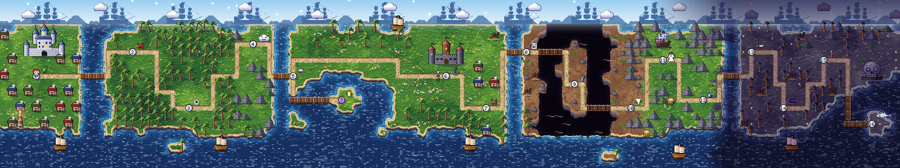
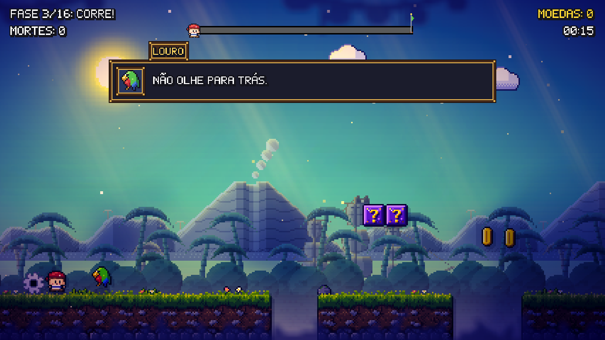
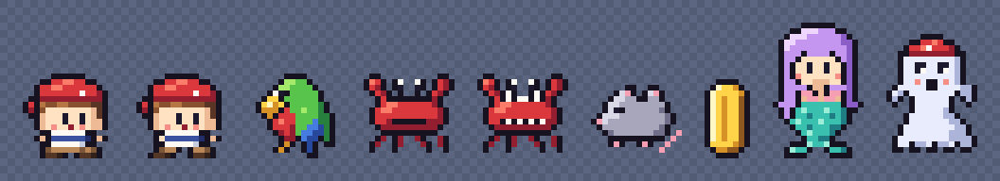
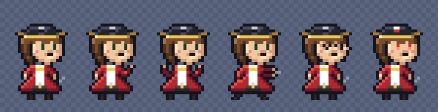
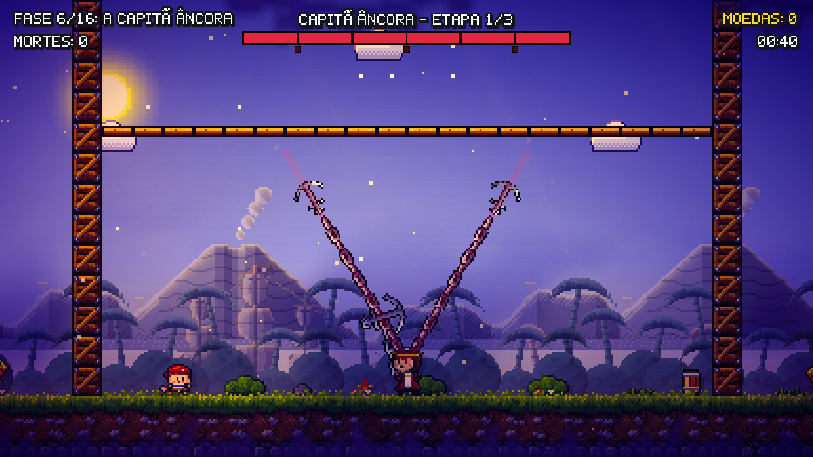

# CILADA À VISTA!

> *Toda morte é só o começo da viagem...*

**CILADA À VISTA!** é um jogo de plataforma 2D "troll", no estilo de *Cat Mario* e *Level Devil*, com o tema de **piratas**.
Você é o Grumete, o marujo mais novo do navio: tudo parece normal, mas o chão cai, espinhos brotam do nada, a bandeira foge e as nuvens têm dentes.
Cada morte é uma **Volta da Maré**: a onda te traz de volta, você lembra onde errou e tenta de novo, de ilha em ilha, até reencontrar a Marina.

- **Jogar no navegador:** (link da página do itch.io)
- **Game jam:** [Projeto Jogo 2D Insper 2026.2](https://itch.io/jam/projeto-jogo-2d-insper-20262)
- **GDD:** [`GDD.md`](GDD.md), organizado pelo DDE (Design, Dinâmica, Experiência). A versão em cartões fica no Milanote: (link do Milanote)
- Jogo **original** feito para a disciplina **Projeto 2D (Insper)**. Não tem fins comerciais.







*O mapa e a folha dos personagens são **prévias** montadas pelas ferramentas de desenvolvimento (sem o pós-processamento);
a fase é uma captura do jogo rodando no editor da Unity.*

---

## Sumário
1. [Como jogar](#como-jogar)
2. [Segredos](#segredos)
3. [As fases](#as-fases)
4. [Os chefes](#os-chefes)
5. [Atalhos de teste (para avaliação)](#atalhos-de-teste-para-avaliação)
6. [Como abrir e rodar no Unity](#como-abrir-e-rodar-no-unity)
7. [Como gerar o build WebGL (itch.io)](#como-gerar-o-build-webgl-itchio)
8. [Estrutura do código](#estrutura-do-código)
9. [Créditos e referências](#créditos-e-referências)
10. [Licença e aviso](#licença-e-aviso)

---

## Como jogar

### Objetivo
Leve o Grumete do começo de cada fase até a **bandeira de verdade**. São 13 fases ligadas por um **mapa do mundo** (estilo *Super Mario World*): um arquipélago, atravessado de ilha em ilha pelas pontes de madeira.
Cada fase tem um lugar e um clima próprios. No caminho há 4 chefes (o último é o **Kraken Vermelho**), e depois dele a Marina, a sereia, espera o Grumete, ao lado do **baú do tesouro**.
Você vai morrer muito, e é assim que o jogo funciona: cada armadilha só pega uma vez, se você prestar atenção.

### Controles
Os controles abaixo são os de `Assets/Scripts/Nucleo/Controles.cs`. Teclado e controle (gamepad) funcionam ao mesmo tempo.

| Ação | Teclado | Controle |
|---|---|---|
| Andar | **A / D** ou **← / →** | analógico esquerdo ou direcional |
| Pular (segure para pular mais alto) | **Espaço**, **W** ou **↑** | botão de baixo (A / ✕) |
| Reiniciar a fase (conta como morte 😈) | **R** | botão de cima (Y / △) |
| Pausar / continuar | **Esc** | Start ou Select |
| Confirmar nos menus | **Enter** ou **Espaço** | Start ou botão de baixo |
| Escolher nos menus | **↑ / ↓** (ou W / S) | direcional |
| Mudar um valor (volume, gráficos) | **← / →** | direcional |
| Pular a animação da morte (depois de 0,5 s) | **Espaço / Enter** | botão de baixo |
| Entrar numa porta do Navio Fantasma | **S** ou **↓** | direcional para baixo |
| No mapa: andar pelo caminho / entrar na fase | **setas** / **Enter** | direcional / botão de baixo |
| No mapa: voltar ao título | **Esc** | Start |
| Voltar um nível nos menus | **Esc** ou **Backspace** | botão da direita (B / ◯) |
| Na pausa: ir direto para o mapa | **Q** | — |
| Menus com mouse | passar o mouse escolhe, **clique** confirma, **botão direito** volta | — |

### Coop local (até 4 jogadores)
No mapa, aperte **T** (ou **Y / △** no controle, ou clique no botão **COOP** no canto de baixo à esquerda) para abrir a **Tripulação**.
Cada jogador aperta **PULAR** no seu aparelho para entrar, na ordem (P1, P2, P3, P4), e a tecla do **balão** para sair. **Enter** fecha a tela.
Sozinho, o jogo continua como sempre: o teclado inteiro e qualquer controle mexem o Grumete.

| Aparelho | Andar | Pular | Porta | Empurrar | Balão (segure) |
|---|---|---|---|---|---|
| Teclado 1 | **A / D** | **W** ou **Espaço** | **S** | **E** | **Q** |
| Teclado 2 | **← / →** | **↑** | **↓** | **Shift direito** | **Ctrl direito** |
| Controle (até 4) | analógico ou direcional | **A / ✕** | direcional para baixo | **X / □** | **B / ◯** |

Se só um jogador usa o teclado, ele fica com o teclado inteiro. As regras:
- **A tela vai com quem corre na frente.** Juntos, ela fica no meio do grupo; espalhados, segue quem está puxando.
  Quem fica para trás e sai da tela vira **balão** (não conta morte).
- **Balão de resgate:** morreu com um companheiro ainda vivo? Você não volta para o checkpoint: volta pendurado num **balão de festa amarrado** nele (da cor do jogador), que vai boiando
  até ficar em cima da cabeça do companheiro mais perto. Ele pula, encosta e **estoura**: você volta ao jogo ali, piscando por 1 s.
  Dentro do balão, as teclas de andar empurram ele para os lados. A morte conta no total da tripulação.
- **Todo mundo morto ou no balão:** a tripulação perdeu e volta inteira para o checkpoint (como a morte de um jogador só).
- **Pulo na cabeça:** cair em cima do companheiro quica, sem limite (dá para ficar quicando nele).
  Segurando PULAR, o pulo sai mais alto que o normal (dá para alcançar lugares novos).
- **Empurrão:** joga para longe o companheiro que está na sua frente. Para ajudar... ou para a cilada.
- **Balão de propósito:** segurar a tecla do balão por meio segundo (para quem ficou preso do lado errado de um buraco).
- **O que é de todos e o que é de cada um:** as moedas e as poções de visão são da tripulação. Os **escudos, o elixir e o duplo salto
  são de cada jogador**: na Loja, **TAB** (ou RB/LB, ou um clique no rostinho) escolhe para quem é a compra.
- **Bandeira de morto e contagem de mortes por jogador:** cada um tem a sua bandeira (com o pano da cor dele), fincada na hora
  em que morre, e ao lado do rostinho de cada um, no canto de baixo, aparecem as mortes dele e os itens dele.
- **Chefes:** quando a luta começa e a arena fecha, quem ficou do lado de fora é puxado para dentro.
  Na escuridão da Cozinheira (e da Baleia), cada Grumete tem o seu círculo de luz.
- **R** reinicia todo mundo do checkpoint e conta uma morte só (que não entra na conta de nenhum jogador).
- No fim da fase aparecem os **títulos da tripulação**: Salva-vidas (mais balões estourados), Mão-leve (mais moedas),
  Âncora (mais mortes) e Traíra (mais empurrões).

### Menus
- **Título:** Continuar (só se houver partida salva), Novo jogo, Opções, Como jogar, Conquistas, Créditos e Sair (o Sair não aparece no navegador).
- **Pausa:** Continuar, Reiniciar fase (do começo, sem contar morte), Opções, Como jogar, Voltar ao mapa e Voltar ao título. O progresso fica salvo.
- **Opções** (a mesma tela no título e na pausa): volume da música, volume dos efeitos, gráficos **HD-2D** ou **Simples**, tela cheia e cronômetro no HUD.
- **Mapa do mundo:** cada ponto é uma fase. Verde = já passou nesta partida, amarelo = liberada. A caveira embaixo do ponto mostra quantas vezes você morreu ali,
  e as 3 medalhas do lado (relógio, coração e moeda) mostram as que você já ganhou. Embaixo da tela aparece o recorde da fase escolhida.
  O mapa começa coberto pela névoa do alto-mar, que vai sumindo conforme você avança.

### HUD
- Em cima, à esquerda: o nome da fase ("Fase 3/13: O Final (mudei de ideia)") e o total de mortes.
- Em cima, à direita: as moedas e o tempo de jogo.
- Uma barrinha de progresso até a bandeira mais distante (de propósito: ela não entrega qual bandeira é a de verdade).
- Nas lutas: a barra de vida do chefe, dividida em 3 etapas.

### Dicas
- **Não confie no Louro.** As dicas do papagaio às vezes ajudam e às vezes mentem. ("Chão 100% seguro à frente.")
- **Não confie em nada que pareça normal:** moedas, nuvens, bandeiras, blocos `?` e até o chão podem ser armadilha.
- Olhe o **X vermelho** ("X marca o lugar!") das suas mortes recentes e a **bandeira de morto** fincada na última: em buraco ou chão falso, ela mostra onde o chão mente.
- O **cristal de save** guarda o ponto onde você renasce... mas na **3ª morte** depois de pegá-lo ele "muda de lugar" e você volta para o checkpoint anterior (sempre na 3ª, dá para contar). Isso não acontece nas fases de chefe.
- Nos chefes, **todo ataque avisa antes** (linha vermelha, "!", marca no chão, olhos vermelhos) e os **padrões são fixos**: dá para decorar.
  Se morrer, você volta **na mesma etapa** da luta.
- A partir da 3ª morte na mesma fase, a animação da morte fica mais curta. Ela também pode ser pulada.

---

### Loja do Porto
Depois da fase 2, o mapa ganha o botão **LOJA** no canto de baixo à direita (ou a tecla **L**). Com as moedas das fases você compra:
- **Escudo** (15 moedas, até 3): te salva de uma morte;
- **Elixir de super salto** (20, até 3): entrar numa fase gasta um, e o Grumete pula bem mais alto a fase inteira;
- **Poção dos espinhos** e **poção do chão** (15 cada, até 3 de cada): mostram os espinhos escondidos e o chão que cai ou falso a fase inteira (só são gastas em fase que tenha o que mostrar);
- **Duplo salto** (45, compra uma vez): um segundo pulo no ar, para a partida toda.

No meio da Loja fica a **roleta**: escolha quanto apostar (de 1 a 100) e a cor. Vermelho e preto pagam 2x, verde (uma casa só) paga 14x.

### Jogos de habilidade (na Loja)
Na Loja, a linha **Jogos de habilidade** abre os jogos do Louro. Aqui não tem sorte nem aposta: cada rodada gasta uma **ficha**
(a partida começa com 3 e o Louro dá 2 a cada fase concluída, até 9) e o prêmio, em moedas, depende só de você.
- **Pontaria:** ENTER solta o ponteiro e ENTER de novo para ele. No verde: 10 moedas. No amarelo: 4. Cada acerto seguido deixa ele mais rápido.
- **Reflexo:** ENTER começa; espere o **JÁ!** e aperte ENTER o mais rápido que conseguir (até 0,30 s: 10 moedas; até 0,45 s: 4).
- ESQUERDA/DIREITA trocam de jogo; ESC volta para a Loja.

### O final: devolver ou roubar
Depois do Kraken, ao encostar no baú, você escolhe o que fazer com o tesouro:
- **Devolver:** o Deus da Riqueza tira a maldição e o jogo termina, com os créditos. O slot continua, com o mapa todo aberto para buscar as medalhas (e vencer o Kraken de novo oferece a escolha de novo).
- **Roubar:** não tem créditos. O jogo recomeça no **modo difícil**: tempestade em tudo (fases e mapa) e um **tsunami perseguindo você em toda fase**, cada uma na sua velocidade.
  Você leva as moedas e os itens e ganha mais 100 moedas do tesouro; mortes e tempo zeram, e os recordes e medalhas do modo difícil são separados.
  Nas fases de chefe a onda para na entrada da arena. Vencer o Kraken de novo dá a última escolha: **devolver** (o final verdadeiro, que acaba com a tempestade) ou **ficar com o ouro** (o final do rei).

---

## Segredos

> ⚠️ Spoilers!

- **Fase secreta, a "Ilha do Louro":** na fase 3, *"O Final (mudei de ideia)"*, pegue **todas as moedas** da fase inteira (as moedas `$` e os blocos `?`) **numa mesma tentativa** e chegue à bandeira.
  Cuidado: uma das moedas é uma **moeda assassina**, e essa não conta. Se você conseguir, o Louro avisa e uma ilhota aparece na lagoa do mapa.
  No **ponto 3** do mapa, aperte **↓ (ou S)** para atravessar a ponte até a ilhota.
  (No código: `Fases.FaseDoSegredo = 2` e `GerenciadorDoJogo.FaseConcluida`. Um Novo jogo esconde a secreta de novo.)
- **Conquistas:** são 31 (lista no título, salvas para sempre). Algumas são segredos, como "Olhou para o céu" (ser mordido por uma nuvem),
  "Mudaram meu save!", "Passageiro da Expressa" (ir até o fim na plataforma expressa sem pular), "Buuu!", "Fora do Ritmo" e "Bolso fechado"
  (vencer o Kraken sem ela roubar nenhuma moeda).
- **Recorde:** zere o jogo **em ordem, desde a fase 1**, com o menor número de mortes. O recorde aparece no título.
- **Recordes por fase e medalhas:** cada fase guarda o seu melhor tempo, o menor número de mortes e o maior número de moedas (valem para sempre).
  Cada um dá uma medalha: **relógio** (passar dentro do tempo da meta; o tempo conta desde a entrada pelo mapa, com as mortes),
  **coração** (passar sem morrer) e **moeda** (pegar todas as moedas numa tentativa só). Ganhar as 3 numa fase dá a conquista "Perfeccionista".
  Se você pular fases pelo mapa, a partida não vale para o recorde.
  Os recordes são guardados pelo **nome** da fase. Com as 13 fases novas (mais longas), os recordes das fases antigas não valem mais: cada fase começa do zero.
- **Título no final:** o número de mortes dá um título ao jogador, de "Suspeito de hack" até "Grumete imortal".

---

## As fases

| # | Fase | Tema (lugar e clima) | Mecânica principal |
|---|---|---|---|
| 1 | Bem-vindo :) | O **porto**, de manhã | Tutorial "mentiroso": chão que cai, bloco invisível, espinho escondido, bloco `?` que solta inimigo, cano com o tentáculo do Kraken e a **bandeira que foge**. |
| 2 | Confia em mim (e corre!) | A **selva**, com folhas caindo | Esmagadores, **nuvem assassina**, chão falso e a primeira **bandeira falsa**; depois, as **serras** (uma persegue você por trás). |
| 3 | O Final (mudei de ideia) | A **lagoa** cor-de-rosa, com pétalas | O "final" que continua: estreia dos **Ratos do Porão** e a **moeda assassina**. É a fase que libera a secreta. |
| 4 | A Capitã Âncora | O **forte** da Capitã | **Âncora giratória** (só a âncora mata), um trecho novo de manguais sobre buracos e o **CHEFE: Capitã Âncora**. |
| 5 | Cadê a direita? (Foge, bloco!) | A **vila** de ponta-cabeça, com poeira dourada | **Controles invertidos** num trecho, **blocos tímidos** e a bandeira que te manda **de volta ao checkpoint**. |
| 6 | Abordagem! | A **baía dos navios**, de noite | De **navio em navio**: os conveses lado a lado e, nos vãos, as **plataformas mágicas** (umas despencam, a "expressa" dispara). |
| 7 | A Gruta da Cozinheira | A **gruta** escura | Fase **no escuro**, com atiradoras de facas na frente e atrás, e o **CHEFE: Cozinheira**. |
| 8 | O Navio Fantasma | O **navio fantasma**, com almas flutuando | As **portas** das cabines da Dóris (um quebra-cabeça de salas) e, saindo pela última, o baile no convés: **blocos do ritmo** ("tic, tic, TAC"). |
| 9 | Vento em Popa! | O **penhasco dos ventos** | **Vento do mar** (agora já no começo, sobre um buraco) e **redemoinhos** (um é traiçoeiro). |
| 10 | A Baleia Branca | O **mar aberto**, de noite | Aquecimento mais longo (espinhos que caem, chão que despenca) e o **CHEFE: Baleia Branca**. |
| 11 | O Tsunami (CORRE!) | A **praia** das ilhas do Kraken, debaixo de tempestade | O **tsunami** que o Kraken levantou vem do mar e persegue você pela fase inteira. Só correr e pular. |
| 12 | O Verdadeiro Final (juro) | O **rochedo** do pôr do sol | Revisão de tudo, agora bem mais longa: chão falso com isca, esmagadores, blocos que fogem, bandeira falsa, serras e ratos. |
| 13 | O Kraken Vermelho | O **alto-mar**, debaixo de tempestade | De convés em convés até o navio do **CHEFE FINAL: Kraken Vermelho**, que rouba moedas. A Marina espera no fim. |
| ★ | Ilha do Louro (secreta) | A ilhota dourada | Só moedas e molas, "sem pegadinha"... ("tá, só uma"). |

A viagem tem **4 chefes**: 3 fases e a Capitã, 2 fases e a Cozinheira, 2 fases e a Baleia, 2 fases e o Kraken.
Fora a primeira, todas as fases são longas (de 112 a 218 blocos) e têm checkpoints no meio.

Cada fase tem um **lugar** (`Fase.bioma`): ele escolhe o chão (grama, areia, tábuas de navio, pedra, gruta, madeira fantasma, terra seca ou recife),
os enfeites do chão, o bicho que anda pela fase (gaivota, sapo, tartaruga, caveira-pirata, galinha, macaco, aranha, fantasminha, escorpião, estrela-do-mar, caranguejo, lagarto ou polvinho; todos do mesmo tamanho e todos morrem com um pisão)
e o fundo pintado com paralaxe (`Assets/Resources/Arte/<lugar>/`; os prompts para gerar cada um estão em `Ferramentas/prompts_dos_fundos.md`).

As fases são desenhadas em texto em `Assets/Scripts/Nucleo/Fases.cs`. Cada caractere é um bloco, e a legenda completa fica no topo do arquivo.

---

## Os chefes

Os quatro seguem o mesmo molde, inspirado no chefe final de *Helltaker*: **3 etapas de 2 golpes**, ataques que matam com um toque mas sempre **avisam antes**,
**padrões fixos** (nada é sorteado) e checkpoint por etapa (morreu, volta na mesma etapa sem a introdução longa). A barra de vida fica no topo da tela.

O único jeito de dar dano é **pular na cabeça** do chefe **no momento certo**: quando ele fica vulnerável (descrito em "Como vencer").
Cada chefe tem **a sua própria música** de luta, e morrer não recomeça a música.



### Capitã Âncora (fase 4)
- Ataques com a âncora presa na corrente:
  - **arremesso:** linha baixa = pule, linha alta = não pule;
  - **tempestade de âncoras:** ela salta para o meio da arena e dispara várias âncoras **rápidas para todos os lados**. Elas cravam na parede,
    no chão ou no teto e **voltam** pelo mesmo caminho. As linhas vermelhas mostram o caminho de cada uma antes:
    linha baixa do seu lado = pule (na ida e na volta); linha que bate no chão = fuja da ponta dela. Na etapa 3 vêm duas rajadas seguidas;
  - **giro:** fique fora do anel vermelho ou colado nela;
  - **salto:** a marca no chão segue você;
  - **golpe de cima:** solta pedras rolando.
- Ela é rápida e emenda um ataque no outro, e na etapa 3 fica **furiosa**: mais rápida ainda, com combos.
- **Como vencer:** depois do golpe de cima, a âncora fica **presa no chão** e a Capitã fica parada puxando a corrente. É a hora: **pule na cabeça dela**.
  Essa janela é mais longa que a dos outros chefes (3 s na etapa 1, 2,7 s na 2 e 2,4 s na 3).



### Cozinheira (fase 7)
- A luta é **no escuro**, na gruta onde ela cozinha desde que foi expulsa do navio fantasma: só aparecem os olhos dela. Olhos vermelhos = vai atacar.
- Ataques com o cutelo: faca mirada, leque de facas, chuva de facas, corte rente (pule), corte alto (não pule), bumerangue e "atrás de você".
- Na etapa 3 a escuridão fecha.
- **Como vencer:** no fim de cada rodada aparece um **lampião**. Encoste nele: o clarão deixa a Cozinheira **tonta** e à vista. **Pule na cabeça dela.**

### Baleia Branca (fase 10)
- Uma orca gigante com chifre. Ataques:
  - **investida:** alta = não pule, baixa = pule;
  - barbatana rasgando o chão;
  - chuva de névoa;
  - correntes;
  - onda de choque;
  - raio do chifre.
- Na etapa 2 vêm dois ataques ao mesmo tempo. Na etapa 3 o chão desmorona em dois lugares, ela faz uma finta e a arena escurece.
- **Como vencer:** no fim de cada rodada ela dá um **mergulho** (a marca no chão segue você e trava). Saia de baixo: ela fica **atordoada**, e você **pula na cabeça dela**.
  Depois de vencê-la, a Marina conta quem mandou a Baleia: o Kraken.

### Kraken Vermelho (fase 13, chefe final)
- A **lula gigante vermelha** que prendeu a Marina, mandou a Baleia e levantou o tsunami. A luta é no **convés de um navio em alto-mar**, e ela sai do mar no fim da arena.
  É o chefe final e a luta mais difícil, com ataques que pedem **coordenação** e **vários tentáculos ao mesmo tempo**.
  **Só a ponta dos tentáculos mata** (e as colunas, a tinta, o mar e o bico). Vermelho mata, **amarelo rouba**:
  - **rajada de chicotadas:** várias seguidas, do mesmo lado e no mesmo ritmo. Linha baixa = pule, linha alta = fique no chão;
  - **pêndulo:** um tentáculo balança de parede a parede. No meio ele passa rente ao chão (pule), perto das paredes passa alto (fique no chão);
  - **convés podre:** as tábuas racham e caem no mar **só onde você pisa** (meio segundo depois) e voltam depois. Não dá para ficar parado!
    Da etapa 2 em diante vem junto com uma rajada de chicotadas;
  - **chuva de tentáculos:** ondas de até 13 tentáculos despencando do céu nas marcas. Fique no buraco; a onda seguinte cai nos buracos da anterior;
  - **erupção:** igual, mas os tentáculos brotam do convés em colunas altas. Na etapa 3 vem junto com o pêndulo;
  - **agarrão (amarelo):** vem rente ao chão atrás de você. **Não mata, rouba moedas** (6, 9 ou 12) e te joga longe. Da etapa 2 em diante vem um de cada lado;
  - **tinta:** as marcas mostram onde as bolas caem;
  - **sucção** (etapa 2 em diante): ela puxa tudo para o mar; segure para a esquerda, porque o bico mata;
  - **tinta na cara** (etapa 2 em diante, como a lula do Mario Kart): borrões de tinta grudam na tela, por cima de tudo, e escorrem por uns segundos.
- Só vêm juntos os ataques que se desviam do mesmo jeito. Na etapa 3 ela fica **furiosa**.
- **Como vencer:** como todo chefe, 3 etapas de 2 golpes (cada etapa é um checkpoint). No fim de cada rodada ela **cansa** e deita a cabeça
  no convés, tonta: **pule na cabeça dela** (3 s, 2,6 s e 2,2 s). Cuidado com o mar!
- **As moedas roubadas:** primeiro saem as que você pegou nesta tentativa, depois as guardadas (nunca fica negativo, e sem moedas ela só empurra).
  O roubo é salvo na hora. A cada pisão ela devolve **metade** do que roubou, e ao ser derrotada devolve **o resto**. Morrer não devolve nada, e o escudo não protege do roubo.
- Música própria: "Oito Braços", em 7/8 (o compasso que "manca") e si bemol frígio, com um cravo martelando, coro, tímpanos e o "lamento" da lula.

---

## Atalhos de teste (para avaliação)

> Estes atalhos existem **para testes e para a avaliação da disciplina**. Eles não fazem parte da experiência normal.

| Tecla | Onde | O que faz |
|---|---|---|
| **F9** | no mapa do mundo | Libera **todas** as fases, os chefes e a secreta, **só na partida atual**. A partida deixa de valer para o recorde, e um Novo jogo volta tudo para a névoa. |
| **F8** | no mapa do mundo | Liga e desliga o **modo difícil** (tempestade e um tsunami em cada fase), sem precisar zerar o jogo. A partida deixa de valer para o recorde. |
| **F7** | no mapa do mundo | Vai direto para a **escolha do final** (devolver ou roubar), como se tivesse vencido o Kraken. Com o F8 ligado, abre a segunda escolha. |
| **F10** (ou a tecla à esquerda do 1) | em qualquer tela | **Painel de gráficos**: liga e desliga cada efeito visual e mostra o FPS e o pior quadro. |

Também dá para começar direto numa fase. Durante o Play, selecione o objeto `GerenciadorDoJogo`, mude **Fase Inicial** no Inspector,
volte ao título e escolha **Novo jogo**.

---

## Como abrir e rodar no Unity

1. Instale o **Unity 6000.6.4f1** (Unity 6) pelo Unity Hub.
   Para gerar o build para o navegador, instale também o módulo **Web Build Support**.
2. Clone o repositório:
   ```
   git clone (link do repositório no GitHub)
   ```
3. No Unity Hub: **Add → Add project from disk** e escolha a pasta do projeto. A primeira abertura importa os pacotes e demora alguns minutos.
4. Abra a cena `Assets/Scenes/SampleScene` e aperte **Play**.
   O jogo se monta sozinho por código: o `GerenciadorDoJogo` se cria ao dar Play, então não é preciso arrastar nada para a cena.
5. No Console deve aparecer `[Cilada à Vista] visual v3 (HD-2D escuro) rodando...`.
   Se essa linha não aparecer, há um erro de compilação (mensagem vermelha) e a Unity está rodando a última versão que compilou.

---

## Como gerar o build WebGL (itch.io)

1. **File → Build Profiles → Web → Switch Platform**.
2. Confira se `Assets/Scenes/SampleScene` está na lista de cenas. Ela é a única cena do jogo.
3. Em **Player Settings → Publishing Settings**:
   - **Compression Format = Gzip**;
   - marque **Decompression Fallback** (assim funciona em qualquer servidor, inclusive no itch.io).
4. Em **Player Settings → Resolution and Presentation**, use 1280 x 720.
5. Clique em **Build** e escolha uma pasta vazia.
6. Compacte o **conteúdo** da pasta em .zip (o `index.html` precisa ficar na raiz do .zip).
7. No itch.io: **Upload new project → Kind of project: HTML**.
   - Envie o .zip e marque *"This file will be played in the browser"*.
   - Tamanho da tela: 1280 x 720, com o botão de tela cheia.
   - Inscreva o projeto na jam: https://itch.io/jam/projeto-jogo-2d-insper-20262
8. Se o navegador ficar lento, use **Gráficos: Simples** no menu de pausa, que desliga os efeitos pesados.

O progresso (PlayerPrefs) fica salvo no navegador de cada jogador.

---

## Estrutura do código

**Tudo é procedural.** O jogo não importa nenhum arquivo de imagem, som ou música:
- **arte:** os sprites são *pixel art escrita em texto* (cada letra é uma cor da paleta) ou desenhados por fórmula, com rampas de cor, dithering e luz de cima-esquerda;
- **fases e mapa:** são desenhados em texto, e cada caractere é um bloco;
- **música:** é **composta e sintetizada por código** (composição original). O sintetizador também foi escrito para o jogo: acordeão, apito, violão, violino,
  as ondas do mar, tambor de mão, pisadas no convés, palmas e o sino do navio, além das ondas "8-bit" de videogame;
- **efeitos sonoros:** são ondas 8-bit geradas por código, e o som da Volta da Maré (a onda e o sino) também.

```
Assets/
  Scenes/SampleScene.unity      a única cena (o jogo se monta por código)
  Resources/Shaders/            2 shaders próprios (luz aditiva e sombra multiplicada)
  Scripts/
    Nucleo/      o "motor" do jogo: estados, fases, mapa, interface, arte, som e efeitos
    Jogador/     o Grumete (física e game feel)
    Armadilhas/  uma classe por armadilha/mecânica
    Objetos/     inimigos, chefes, bandeiras, placas, portas, moedas, save
Ferramentas/     scripts de apoio (checador de fases, gerador das músicas em WAV) e prévias em imagem
```

### Nucleo/
- `GerenciadorDoJogo.cs`: a máquina de estados (Título, Conquistas, Mapa, Jogando, Pausado, Morreu, FaseConcluida, Vitória, Créditos), as mortes, as moedas, o tempo e os checkpoints.
- `Fases.cs`: as 13 fases e a secreta desenhadas em texto (cada uma com o seu tema: cor do céu, noite, escuro e partículas), a legenda das mecânicas e as mensagens de morte.
- `ConstrutorDeFase.cs`: lê o texto da fase e cria os objetos (o chão vira um único `CompositeCollider2D`).
- `MapaDoMundo.cs`: o mapa do mundo em texto (o arquipélago), com caminhos, pontes, névoa e o Grumete andando.
  A arte do mapa fica em `ArteDoMapa.cs` (o chão, o mar e as praias) e `ArteDoMapaEnfeites.cs` (palmeiras, forte, navios, farol, Rocha da Caveira...),
  e a névoa e a animação em `NevoaDoMapa.cs` e `VidaDoMapa.cs`.
- `Interface.cs`: tudo o que é desenhado por cima do jogo (HUD, menus, pausa, morte, falas, barra do chefe, transições). Usa IMGUI e a fonte pixel própria.
- `Controles.cs`: a leitura de teclado e controle (Input System).
- `Progresso.cs`: o save em PlayerPrefs, com validação de versão. A partida (fase, mortes, moedas, tempo, itens da Loja, mortes por fase e secreta)
  fica em um de **3 slots** (`cilada_slot1_...`); o título tem "Continuar" (último slot usado), "Carregar jogo" e "Novo jogo" (a tela dos slots,
  com DEL ou a lixeira para apagar). Os recordes, as medalhas e os melhores tempos de cada fase (guardados pelo nome da fase) também são de cada slot;
  o recorde do título (zerar com menos mortes) e as conquistas valem para o jogo todo.
  O save de antes dos slots vira o Slot 1 sozinho na primeira vez.
- `Medalhas.cs`: as 3 medalhas de cada fase (tempo, sem morrer, todas as moedas), o tempo-alvo e o desenho delas.
- `Conquistas.cs`, `Opcoes.cs` e `Textos.cs`: as 31 conquistas, o volume e os gráficos, e as falas do mapa e os créditos.
- `Historia.cs`: a história contada em quadros (cutscenes): a abertura (num Novo jogo, antes do mapa), a escolha do baú (depois do Kraken) e os finais.
  O modo difícil é o `GerenciadorDoJogo.ModoDificil` (salvo no slot); `Fase.velocidadeDaOnda` ajusta o tsunami de cada fase e `Relampago.cs` faz os relâmpagos.
  As imagens (256 x 144) ficam em `Assets/Resources/Arte/historia/` e são desenhadas por `Ferramentas/historia/desenhar_historia.py`,
  que lê os desenhos dos personagens direto dos .cs (mudou um personagem? rode o script de novo).
- `Idioma.cs` e `Traducoes.cs`: o jogo em Português ou Inglês (botão "Idioma / Language" no título, salvo no PlayerPrefs).
  A Interface traduz sozinha todo texto que desenha, procurando em `Traducoes.cs` (pares "português" -> "inglês");
  textos montados com números usam `Idioma.T("pt", "en")` direto no código. Mudou um texto em português? Mude a chave em `Traducoes.cs` também.
- `ArteDosPersonagens.cs`: o Grumete, o Louro, os caranguejos, o rato, a Marina, a Dóris e a moeda, com uma paleta de três tons por material.
- `FabricaDeSprites.cs` e `ArteDosBlocos.cs`: a arte procedural dos blocos, dos enfeites e dos fundos, o sombreamento automático dos desenhos grandes
  e a fonte pixel com acentos.
- `Musicas.cs`: **todas** as músicas (a jiga das fases, a balada do mapa e a música de luta de cada um dos 4 chefes), escritas em texto (como as fases)
  e tocadas por um sintetizador próprio. É C# puro, sem Unity, então dá para gerar os WAVs fora do jogo.
- `FabricaDeMusica.cs` e `Musica.cs`: transformam as músicas em AudioClips (cada fase num tom um pouco diferente) e tocam a música de fundo.
- `FabricaDeSons.cs`, `SomDaMare.cs` e `SonsDaMorte.cs`: os efeitos 8-bit e o som da Volta da Maré (a onda, o sino do navio e o lamento do acordeão), sincronizado com o renascimento.
- `EfeitosDeTela.cs`: o pós-processamento do URP (bloom, vinheta, cor de cinema e o efeito da morte).
- `TelaPixelada.cs`: pixel nítido em escala inteira (e o tilt-shift opcional, desligado de fábrica: liga no F10).
- `FeixesDeLuz.cs`, `SombrasDeNuvens.cs`, `Vento.cs` e `LuzDoDia.cs`: raios de sol, sombras de nuvens, plantas ao vento e a hora do dia.
- `Paralaxe.cs`, `PrimeiroPlano.cs`, `Ambiente.cs`, `Luzes.cs`, `ArteHD2D.cs` e `MateriaisHD2D.cs`: o fundo em camadas (ilhas, galeão, palmeiras, nítidas e com a luz pintada), o primeiro plano, as partículas, as luzes 2D e os materiais.
- `CameraSeguir.cs`, `Efeitos.cs`, `Particula.cs`, `MarcaDaMorte.cs` e `Sombra*.cs`: a câmera com tremida, a poeira, o X vermelho e a bandeira das mortes e as sombras.
- `AjustesVisuais.cs` e `PainelDeGraficos.cs`: os valores de cada efeito e o painel de testes (F10).

### Jogador/
- `Jogador.cs`: física com Rigidbody2D, pulo variável, *coyote time*, *buffer* de pulo, estica-e-achata e a inversão de controles.
- `JogadorCoop.cs`: a outra metade do Grumete (classe parcial), só do coop: o balão de resgate, o pulo na cabeça do companheiro e o empurrão.

### Coop (onde fica cada parte)
- `Nucleo/Tripulacao.cs`: quem são os jogadores, o aparelho e as teclas de cada um, a tela da Tripulação e o placar da fase.
- `Nucleo/GerenciadorCoop.cs`: a outra metade do `GerenciadorDoJogo` (classe parcial): cria um Grumete por jogador, escolhe quem "puxa"
  a câmera, transforma em balão quem saiu da tela e dá os títulos do fim da fase. Também tem `JogadorMaisPerto` e `ProximoVivo`,
  que as armadilhas e os chefes usam para olhar **todos** os Grumetes vivos (e não só o líder).
- `Nucleo/InterfaceCoop.cs`: a outra metade da `Interface`: o botão e a tela da Tripulação, os rostinhos na fase e a caixa dos títulos.
- `Assets/Editor/TesteDoCoop.cs`: o teste automático do coop (menu **Cilada (teste) > Testar coop**): cria controles de mentira e confere
  o balão, a câmera, o pulo na cabeça, o empurrão e a volta para o save numa fase reta.

### Armadilhas/
- `Perigo.cs`: a base ("encostou, morreu").
- Armadilhas clássicas: `ChaoQueCai`, `EspinhoEscondido`, `EspinhoQueCai`, `Espinho`, `BlocoInvisivel`, `BlocoSurpresa`, `BlocoQueFoge`, `Mola`, `Serra`, `Esmagador`, `Cano`, `NuvemAssassina` e `MoedaAssassina`.
- Mecânicas temáticas: `Ancora`, `PlataformaMovel`, `VentoDoMar`, `BlocoDoRitmo`, `EsmagadorDoRitmo`, `FacasDaCozinheira` e `Tsunami` (a onda que persegue).

### Objetos/
- `Chefe.cs`: a base dos chefes (as rodadas de ataques e o pisão na cabeça, que só vale no momento em que o chefe fica vulnerável).
- Os chefes: `ChefeCapita.cs` (com a tempestade de âncoras), `ChefeCozinheira.cs`, `BaleiaBranca.cs` e `ChefeKraken.cs` (o chefe final, que rouba moedas),
  com a arte em `ArteDaCapita.cs`, `ArteDaBaleia.cs` e `ArteDoKraken.cs` (que também pinta de vermelho os tentáculos do cano e da tela de morte).
- `Inimigo` (o caranguejo) e `Rato` (o Rato do Porão).
- `Bandeira`, `BandeiraFalsa`, `BandeiraFujona` e `BandeiraVolta`.
- `Placa` (o Louro e a Dóris), `Porta`, `PontoDeSave`, `Moeda` e `Sereia` (a Marina).

### Ferramentas/
- `extrair_fases.py`: tira os mapas de `Fases.cs` e grava em JSON.
- `checar_fase.py`: simula a física do `Jogador.cs` e confere se o terreno de cada fase dá para passar.
- `previews/`: imagens de prévia do mapa, dos fundos e dos chefes.
- `ouvir_musicas/`: gera todas as músicas (e os sons da morte) em WAV, sem abrir a Unity (para mexer nas notas e ouvir na hora):
  ```
  dotnet run --project Ferramentas/ouvir_musicas -- Builds/musicas
  ```
  O `dotnet` que vem com a Unity serve (`Editor/Data/DotNetSdk/dotnet.exe`). A pasta `Builds/` não vai para o git.

### Criar uma fase nova
1. Copie um bloco `new Fase { ... }` em `Fases.cs` e desenhe a fase com os caracteres da legenda.
2. Ponha o número dela no desenho do `MapaDoMundo`, ligado à fase anterior por um caminho de `+` (ou de `=`, a ponte por cima do mar).
3. Ponha a fala do mapa em `Textos.DepoisDaFase`.
4. Teste o terreno:
   ```
   python3 Ferramentas/extrair_fases.py Assets/Scripts/Nucleo/Fases.cs /tmp/fases
   python3 Ferramentas/checar_fase.py /tmp/fases/fase_00.json --de s
   ```

---

## Créditos e referências

### Equipe
> Edite com os nomes e as funções de cada integrante.

| Integrante | Função |
|---|---|
| (Nome do integrante 1) | (função: ex. programação, chefes) |
| (Nome do integrante 2) | (função: ex. level design, fases) |
| (Nome do integrante 3) | (função: ex. arte, efeitos visuais) |
| (Nome do integrante 4) | (função: ex. som, GDD, testes) |

### Mundo e personagens
- O mundo (o arquipélago, o porto, o navio fantasma, as ilhas do Kraken) e os personagens (o Grumete, a Marina, o Louro, a Dóris,
  a Capitã Âncora e a Cozinheira) foram **criados pela equipe** para este jogo.
- A **Baleia Branca** é uma homenagem a *Moby Dick*, de **Herman Melville** (1851, obra em domínio público). O desenho e a luta são nossos.
- O **Kraken** vem das lendas de marinheiros da Escandinávia (folclore, domínio público). Aqui ele é uma lula gigante vermelha; o desenho, a luta e a música são nossos.
- Todos os desenhos foram feitos para este jogo, em pixel art por código.

### Áudio
Todo o áudio é **composição original gerada por código**: a música das fases, a do mapa, a de cada chefe, o som da Volta da Maré e os efeitos sonoros
(`Musicas.cs`, `FabricaDeMusica.cs`, `SomDaMare.cs` e `FabricaDeSons.cs`). Nenhum arquivo de áudio externo é usado.

### Inspirações de design
- **Cat Mario / Syobon Action** e **Level Devil**: as armadilhas que subvertem o que o jogador espera.
- **Helltaker**: as lutas de chefe (etapas com checkpoint, ataques telegrafados e padrões fixos).
- **Super Mario World**: o mapa do mundo.
- **Octopath Traveler** (HD-2D) e **Stardew Valley** (e seus mods visuais): o visual (pixel art com luz, desfoque de profundidade, raios de sol e sombras de nuvem).
- Músicas de taverna e de marinheiro (jigas em 6/8, baladas do mar): o clima da trilha.
  Nenhum asset, música ou código desses jogos foi usado: só as ideias.

### Pacotes e tecnologia
- **Unity 6 (6000.6.4f1)**, com o template 2D URP da Unity.
- Pacotes da Unity usados pelo código:
  - **Universal Render Pipeline** `com.unity.render-pipelines.universal` 17.6.0 (renderizador 2D, luzes 2D e pós-processamento);
  - **Input System** `com.unity.inputsystem` 1.20.0.
- Outros pacotes que vieram com o template (em `Packages/manifest.json`), mas que o jogo não usa diretamente:
  - 2D Sprite, Tilemap, Tilemap Extras, Animation, SpriteShape, Aseprite Importer, PSD Importer e 2D Tooling;
  - uGUI, Timeline, Visual Scripting, Test Framework, Collab Proxy e a integração com IDEs (Rider e Visual Studio);
  - Unity AI Assistant e AI Inference, Pipeline e IET Framework.
- A pasta `Assets/Welcome` e o `InputSystem_Actions.inputactions` vieram do template 2D da Unity.
- **Fontes:** nenhuma fonte externa (.ttf/.otf). O texto usa uma fonte pixel desenhada em código (`FabricaDeSprites.TextoEmPixel`).
- **Imagens:** nenhuma imagem externa no jogo. Os sprites são gerados em tempo de execução.
- **Shaders:** `LuzAditiva` e `SombraMultiplicada`, escritos para este projeto.

### Ferramentas usadas
- **Unity 6** e **C#**: o jogo.
- **Python 3**: as ferramentas em `Ferramentas/` (extrair fases, checar se o terreno dá para passar, gerar prévias).
- **.NET** (o que vem com a Unity): o gerador das músicas em WAV (`Ferramentas/ouvir_musicas`).
- **Git e GitHub**: versionamento.
- **Milanote**: o GDD.
- **Assistente de IA (Claude, da Anthropic)**: usado como ferramenta de apoio ao desenvolvimento (programação, revisão e documentação), sob direção e revisão da equipe.

---

## Licença e aviso

Projeto **acadêmico** feito para a disciplina Projeto 2D do Insper (2026). **Não comercial.**
O jogo, os personagens, a arte procedural, a música e o código foram feitos pela equipe e podem ser estudados para fins educacionais.
